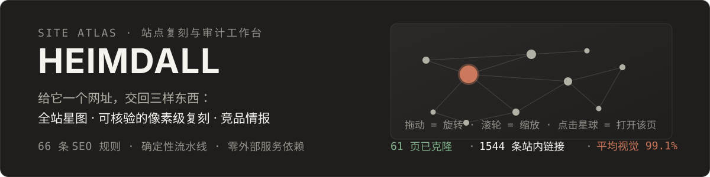
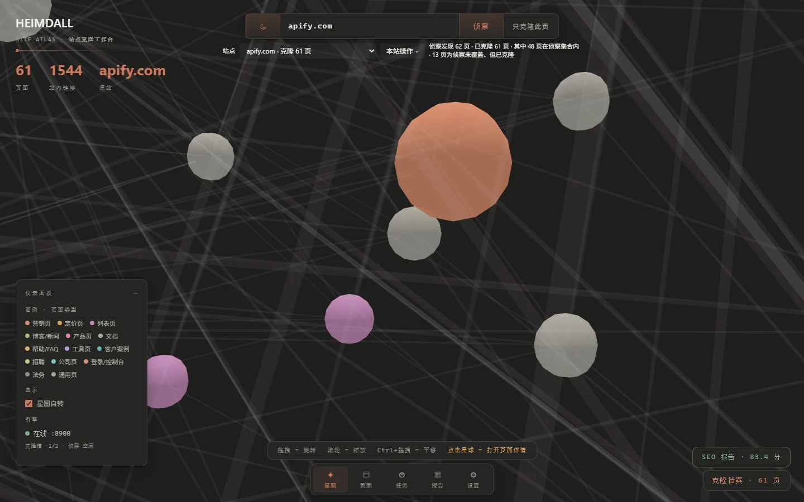
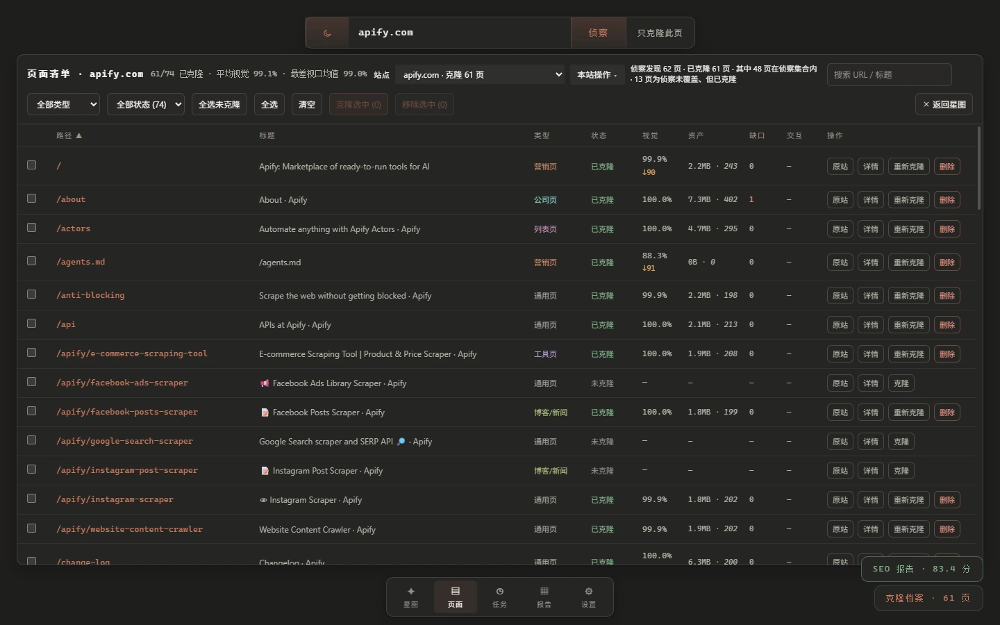
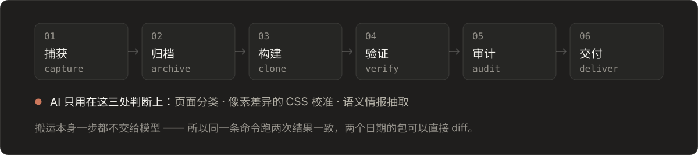

<p align="center">
  
</p>

<p align="center">
  <b>给它一个网址，还你一份能核对的复刻件</b><br>
  <sub>把站点真实资产抓下来、量出和原站差多少、再把差异整理成能直接开工的接手包与 AI 重建闭环。</sub>
</p>

---

**三件事：**

1. **克隆**——把页面结构和真实资产（CSS、图片、字体、脚本）抓到本地，生成可以打开看的静态与交互镜像。
2. **量差异与重建**——渲染原站和克隆（或 AI 重建候选），按三视口（375 / 768 / 1440）逐像素比对，给出**实测**还原度与结构化修复包（Fix Packet）。
3. **给结论与交付**——一张全站星图看清结构，一份改站清单告诉你换域名/换图/换文案各要动哪些文件，外加离线独立部署包、SEO 审计与竞品情报。

Windows 双击根目录的 `clone-heimdall.cmd` 即可。第一次运行会自动检查 Node/pnpm、
安装缺的依赖与 Chromium、构建控制台和 MCP、启动单端口引擎，然后打开
`http://127.0.0.1:8900`；以后再次双击会复用已经就绪的部分。

也可以从终端运行：

```powershell
node bin/heimdall.mjs setup
```

`setup` 默认把 MCP 写进检测到的 Claude Code / Claude Desktop / Codex。
只想打开界面、不改客户端配置时，运行 `node bin/heimdall.mjs setup --no-connect`。
完整步骤见 [USAGE.md](USAGE.md)，小白演示见
[09 · 小白一站式启动](docs/guide/09-beginner-demo.md)，工程细节见
[当前架构](docs/guide/01-architecture.md)。

不想点界面、想一条命令跑完（侦察 → 克隆 → 验证 → 资产 → 交付）：

```bash
node core/src/cli.mjs handoff https://example.org --max-pages 40
# 把本次侦察发现的全部同源页交给克隆队列（侦察范围仍由 --max-pages 控制）
node core/src/cli.mjs handoff https://example.org --max-pages 40 --all-discovered
```

跑完在 `core/workspace/<站点>/handoff/README.md` 会有一份交接说明，第一段就写清"发现多少页、完整测到多少页、没测到的卡在哪"——没测到的地方不会藏起来。

需要同时要求独立离线包通过时，在命令后加 `--strict`；它会复用 `live --offline --strict --root mirror`，失败时保留候选包和 `health.json`。大 HAR 可在人工审核后加 `--privacy-max-file-bytes N`，默认仍是 16 MiB。

---

## 它实际长这样

左边是全站星图：每个星球是一页，大小按被站内链接的次数，连线是页与页之间的链接。右边是同一批页面的清单，每一行的「视觉」是**实测出来的**还原度，不是估计值。

<p align="center">
  
  <br>
  
</p>

上图与以下数字是 **2026-10-13 前的历史样例**：apify.com 当时记录 **61 页已克隆、1544 条站内链接、平均单页像素 99.1%**；其它样例包括 cn.vuejs.org 100.00%、vitest.dev 99.96%、svelte.dev 100.00% / 99.91%、angular.dev 100.00% / 99.76%。这些是旧评分口径下的运行快照，未按当前多视口 v2 算法重算，不能作为当前站点质量或全站覆盖率保证。

---

## 它产出什么

| 产物 | 形态 | 给谁 |
| --- | --- | --- |
| **静态镜像** | `deliverable/<host>-<date>/`：镜像页 + 原站 CSSOM + 渲染后 DOM + 差异热图 + 还原度 CSV + 接手 README | 前端：照着写自己的第一版 |
| **交互镜像** | `deliverable/<host>-live-<date>/`：Dockerfile + `serve.mjs` + HAR 回放 + 健康报告 | 运维/前端：`docker compose up -d` 直接对着它写代码 |
| **AI 重建工程** | `heimdall rebuild init`：可维护的 HTML/CSS 或 Vite+React+TS+Tailwind 工程 + 逐段 Fix Packet + 六维正式门禁 | 前端/AI 代理：直接产出可维护源码 |
| **改站起点** | `edit-manifest.md`：换域名 / 换图片 / 换文案各要动哪些文件，按"被多少页用到"排序 | 拿去做二次改造的人：从哪下手 |
| **SEO 审计** | `workspace/<host>/seo/`：HTML 报告 + CSV + JSON，66 条规则六分类，并附 GEO 准备度与行动计划 | SEO / 增长 |
| **竞品情报** | `intel/<host>-intel.xlsx`：概览 / 语义情报 / 定价与 CTA | 产品 / 市场 |
| **全站星图** | `workspace/<host>/recon/atlas.json` + 控制台 3D 视图 | 所有人：先看清这个站的结构 |

---

## 为什么它和「让 AI 照着截图重写一遍」不是一回事

<p align="center">
  
</p>

四点具体差别：

- **资产是真的** —— 原站的字体、图片、图标原件直接搬下来，不是照着截图的近似重绘
- **保真度是带口径的数字** —— 单页 `score.json` 记录克隆时像素 / DOM 结构 / 字段覆盖，并用 `inputSha256` 绑定当前克隆输入；多视口 `verify.json` v2 另记录原/镜像尺寸、覆盖率和缺口。旧或已过期产物需重算后再比较
- **当前多视口结果须核验** —— 控制台与 AI 会核对克隆内容和测量证据；历史记录或无法完成核验时不作为当前通过。总览中的历史计数不等于当前计数
- **缺口可枚举** —— 每份包都带自己的缺口清单（CSS 引用、HTML 引用、离线资源、内容缺口），不藏起来
- **可追溯** —— 固定输入、会话、时间窗口和运行配置时，流程结果可复现；站点内容和根级元数据变化仍会影响两次产物

---

## 快速开始

**运行前先确认授权和环境：** 克隆、侦察、SEO 与监控会打开真实网页，页面脚本可能发送写请求、连接第三方或使用已保存的登录态；它们不是只读沙箱。优先在测试环境验证，生产数据应先做好保护。详细边界见 [使用说明](USAGE.md)。

```bash
git clone <repo> && cd heimdall
pnpm -C core install --frozen-lockfile
pnpm -C console install --frozen-lockfile
pnpm -C core exec playwright install chromium
```

**只想先试一页**（不需要先启动引擎）：

```bash
node core/src/cli.mjs forge https://example.com home
```

**要完整流程**（控制台 + 引擎同一个地址）：

```bash
pnpm -C console build
cd core && HEIMDALL_CONSOLE_DIR=../console/dist node src/engine-server.mjs 8900
# 打开 http://127.0.0.1:8900 —— 第一次打开是一片空白星图，页面上会写清接下来三步怎么做
```

Windows PowerShell 启动同一服务：

```powershell
pnpm -C console build
Set-Location core
$env:HEIMDALL_CONSOLE_DIR = (Resolve-Path ../console/dist).Path
node src/engine-server.mjs 8900
```

命令行也可以跑完整条链：

```bash
cd core
node src/cli.mjs recon example.com 60                  # 侦察全站 → 星图
node src/cli.mjs queue example.com --all-discovered     # 把本次侦察的全部同源 URL 入队（断点续跑）
node src/cli.mjs queue example.com --incremental       # 站点改版后：只重跑源站变了的页
node src/cli.mjs verify example.com --all              # 多视口保真验证
node src/cli.mjs live example.com --offline --strict --root mirror  # 断网验收后导出
node src/cli.mjs deliver example.com                   # 打包成前端可接手的交付包
```

`node src/cli.mjs`（不带参数）列出全部命令。
裸 `live <host>` 导出的是允许未命中请求回源的在线包；`--offline --strict` 会对已发现页面和声明的操作流程执行断网门禁，缺口会保留为候选包而不覆盖旧正式包。操作流程的声明方式见 [USAGE.md](USAGE.md)。

---

## 能力清单

**克隆**
- 单页 / 全站队列（持久化、断点续跑、末尾 CAS 去重）；中断了能在控制台一键续跑
- 样式表 `@import` 就地展开，外链字体与深层 CSS 资源完整落盘
- 响应式变体还原（多视口快照 + 低分页自动升级）
- 画布内容光栅化（JS 绘制的 `<canvas>` 转静态图，否则脚本一剥就是空白）
- 视频封面截取（无 poster 的 `<video>` 归零到第 0 帧截一张当封面）
- 自定义媒体组件兜底（`<mux-player>` 这类靠脚本建 shadow DOM 的组件，直接用它声明的 `poster` 换成 ``）
- 站点配方三层合并（内置默认 → 运行时学到 → 人工整理），换站不用改代码

**验证与 AI 重建**
- 多视口（375 / 768 / 1440）像素 diff；交互回放须在命令行显式开启
- **差异形态分析与 Fix Packet**：区分"某块内容缺失（集中）"与"文字抗锯齿差异（弥散）"，并点名参考页存在而候选页缺失的文本内容
- 本地确定性六维正式门禁（`heimdall gate formal`）：基线净化 + 视觉、结构、设计令牌、交互、资源健康、防作弊六维核验
- 原站 ↔ 镜像同步滚动对比工具；资产缺口扫描（视觉缺口与元数据噪声分开统计）

**审计**
- SEO 66 条规则 / 六分类：抓取索引、内容语义、结构化数据、性能体验、链接架构、安全合规
- GEO 准备度：基于已采集证据评估 AI 可回答、可抽取、实体清晰和引用准备
- 服务端 HTML vs 渲染后对比（识别 JS 渲染依赖，含 hreflang 校验）
- 变更监控（基线快照 + 去噪）+ **SEO 回归门禁**（可接 CI，回归自动红）
- 跨站对标矩阵（站点分 / 覆盖率 / LCP / 页面类型）

**交付**
- 静态镜像包（前端改造素材 + 接手 README）
- 交互镜像包（Docker + HAR 回放 + 健康报告 + 三级回退 + B1/B2/B3 观察型后端适配器脚手架）
- **改站起点清单 + 域名替换**：列出换域名 / 图片 / 文案各要动哪些文件；
  替换默认只预览，真改前逐文件备份、可逐字节还原
- 交付包保留策略（按站点与类型保留最近 N 份；旧包经预览确认后同卷隔离、可恢复）

**运维**
- 内容寻址存储（CAS）+ 硬链接去重，删站真的释放磁盘（`nlink===1` 判据）
- 磁盘占用看板 + 孤儿回收（安全预览 → 二次确认）
- 控制台配置第三方大模型（Key 只落本地、永不回显）

---

## 仓库结构

```
core/            确定性引擎（运行时不依赖外部服务）
  src/crawler/     捕获、构建、链接接线、站点配方
  src/agent/       AI 重建、Fix Packet、正式门禁与交付兜底
  src/seo/         SEO 规则引擎、采集、报告、回归基线
  src/live/        交互镜像导出、契约与回放适配器、健康检查、自愈
  src/differ/      像素与 DOM 差异
  src/verify/      多视口验证、交互回放
  src/audit/       资产、存储、交付包治理
  src/deliver/     改站起点清单、域名替换
  sites/           人工整理的站点配方（进 git）
console/         Vue 3 控制台（星图、页面、任务、报告、设置）
packages/mcp/    MCP v2 服务、协议测试与单文件插件构建
plugin/          Claude 插件与生成后的 MCP 单文件入口
bin/             heimdall CLI 入口
config/          SEO 门禁的目标站点与基线（进 git）
docs/            路线图、交付说明、上手导览（docs/guide/）
```

数据目录：`core/workspace/`（产物）与 `core/deliverable/`（交付包），
可用 `HEIMDALL_DATA_DIR` 移出仓库。两者都不进 git。

---

## 质量门

```bash
pnpm -C core exec playwright install chromium   # 先装浏览器
pnpm lint          # 语法检查（core 的 src / scripts / test）
pnpm test          # 快速集：无浏览器的单测与流程测试
pnpm test:full     # 全量：含真浏览器与控制台 E2E
pnpm smoke         # 离线 E2E（本地 fixture，不联网）
pnpm -C packages/mcp test  # MCP 协议与插件单文件检查
pnpm -C console build
pnpm run audit     # core / console / MCP 三套官方 registry 依赖审计
pnpm check         # lint + 文档 + 构建 + 快速集 + MCP + 技能同步 + 依赖审计
```

---

## 文档导航

| 文件 | 内容 | 什么时候读 |
| --- | --- | --- |
| **[docs/STATUS.md](docs/STATUS.md)** | **当前状态**：主线、能跑的命令、验证口径、已知边界 | **每次接手先看这一页** |
| [docs/guide/README.md](docs/guide/README.md) | 上手导览：架构、控制台、功能全解（带类比，配图） | 第一次接触这个项目 |
| [USAGE.md](USAGE.md) | 完整使用指南（启动、克隆、查看、部署） | 上手时 |
| [PRD.md](PRD.md) | 产品定义：用户、定位、验收等级、产品原则 | 想知道"为什么做这个" |
| [docs/prd/ai-native/](docs/prd/ai-native/README.md) | AI 接入层（Bifröst）：能力注册表、MCP/CLI/HTTP、重建环与门禁 | 规划 AI 接入时 |
| [docs/guide/01-architecture.md](docs/guide/01-architecture.md) | 当前架构：三层、适配器、还原度公式、产物规范 | 改代码前 |
| [docs/guide/06-ai-integration.md](docs/guide/06-ai-integration.md) | 接入 Claude Code / Claude Desktop / Codex，跑通一句话重建 | 接入代理时 |
| [docs/guide/08-ai-workflows.md](docs/guide/08-ai-workflows.md) | Claude Code / Codex 的克隆、重建、SEO 和监控标准提示词 | 已经接通 MCP 时 |
| [docs/guide/09-beginner-demo.md](docs/guide/09-beginner-demo.md) | 小白启动、完整主流程演示、AI 接入真实边界与常见坑 | 第一次上手时 |
| [docs/DELIVERY.md](docs/DELIVERY.md) | 三种产物的区别、认证站点怎么处理 | 想知道"我该拿哪一种走" |
| [RISKS.md](RISKS.md) | 合规红线与技术风险预案 | 部署或评测前 |
| [VISUAL-SYSTEM.md](VISUAL-SYSTEM.md) | 控制台设计系统（令牌、字体、3D 星图规范） | 改界面前 |
| [docs/ROADMAP.md](docs/ROADMAP.md) | 还没做的事与长期维护 | 排下一批 |
| [docs/archive/](docs/archive/README.md) | 历史开发记录与旧文档 | 想知道"为什么这样写" |

---

## 边界

- **静态复刻**：自有或明确获授权的页面。需要鉴权的站点要先人工登一次（控制台「登录并保存会话」）；
  登录态之后的侦察 / 克隆 / 审计会自动带上。认证数据不应未经清洗直接进入可分发 HAR 或公开静态目录
- **不做的**：外链分析、关键词研究、排名追踪 —— 那是需要买数据源的生意
- **动效**：静态镜像保留 CSS 动画与过渡，并可把部分揭示类和捕获到的 `Element.animate()` 关键帧重演为 CSS；行内样式轮播、画布/WebGL 等仍是捕获帧。交互镜像保留原脚本，能否正常运行取决于资源和原站环境。动效档案 `motion.md` 与重演结果 `motion-replay.css` 可逐页核对
- **合规红线**：只碰公开页面，或操作者本人有权访问的页面；不实现任何访问控制绕过
- **用途**：技术分析与自用改造的**起点**，不是"换皮上线"的许可证 —— 详见 [RISKS.md](RISKS.md)

---

<p align="center">
  <sub>
    命名出自北欧神话的全视之神海姆达尔 —— 能看穿九界、听见草生长的声音。
  </sub>
</p>
