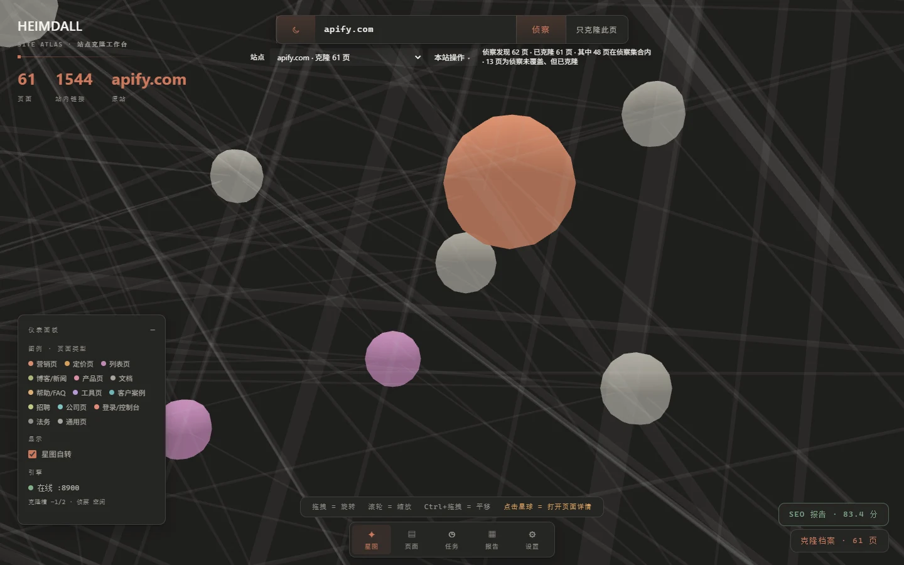
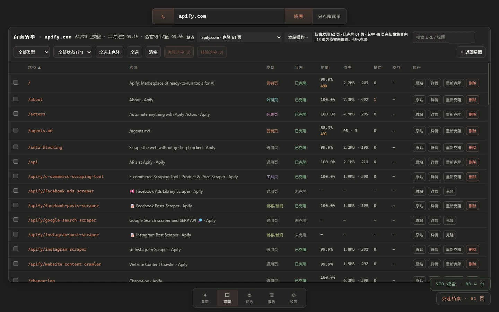
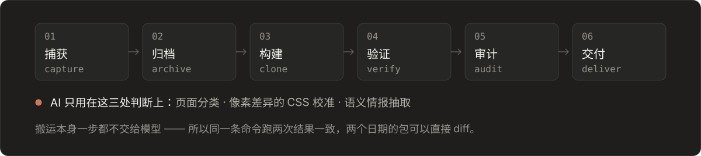

<p align="center">
  
</p>

<p align="center">
  <b>给它一个网址，还你一份能核对的复刻件</b><br>
  <sub>把站点真实资产抓下来、量出和原站差多少、再把差异整理成能直接开工的接手包。</sub>
</p>

---

**三件事：**

1. **克隆**——把页面结构和真实资产（CSS、图片、字体、脚本）抓到本地，生成可以打开看的镜像。
2. **量差异**——渲染原站和克隆，按视口逐像素比对，给出**实测**还原度（不是估计），并列出缺口。
3. **给结论**——一张全站星图看清结构，一份改站清单告诉你换域名/换图/换文案各要动哪些文件，外加 SEO 审计与竞品情报。

跑起来只要两步（前提：Node ≥ 20.19、pnpm）：

```bash
cd core && pnpm install && cd ../console && pnpm install && cd ..
```

```bash
./clone-heimdall.cmd
```

浏览器会打开 `http://127.0.0.1:5173`；把网址贴进左上角的输入框即可。完整步骤见 [USAGE.md](USAGE.md)，工程细节见 [ARCHITECTURE.md](ARCHITECTURE.md)。

不想点界面、想一条命令跑完（侦察 → 克隆 → 验证 → 资产 → 交付）：

```bash
node core/src/cli.mjs handoff https://example.org --max-pages 40
```

跑完在 `core/workspace/<站点>/handoff/README.md` 会有一份交接说明，第一段就写清"发现多少页、完整测到多少页、没测到的卡在哪"——没测到的地方不会藏起来。

---

<details>
<summary><b>进阶：项目验收（按固定清单自动验收一个改版/Mirror）</b>——点开看能力与当前边界</summary>

> 这部分是给"改版完要证明没改坏"的场景准备的：先录一份基线运行，改完再跑一次，
> 工具逐项核对三视口视觉、结构、运行健康与交互，并把结果分成"仍失败 / 复验通过 /
> 新增失败 / 未复验 / 不可比"。AI 只负责**解释**，最终门禁由确定性检查决定。
> 下列条目是内部里程碑记录，适合想了解实现细节的读者。

新增 **项目验收**：Mirror / Regression 对照运行基线与目标项目，检查三视口视觉、结构、运行健康与交互；Spec 依据批准清单和 OpenAPI JSON 候选检查只读 API，检出 HTTP 200 中的业务错误与字段缺陷。可显式选择两次运行，核对仍失败、可靠复验通过、新增失败、未复验与不可比；每次比较重新校验报告与证据。本地项目支持不可变版本声明、历史运行归属，以及 Spec 需求候选的完整预览、显式批准和独立选用；写入受目录版本冲突与双引擎保护。托管 Spec 已接入[专用 HTTP 执行链](docs/competition/acceptance-managed-spec.md)：以完整新确认和明确目标版本启动真实检查，共享运行槽，支持取消、超时和保守重启恢复；控制台已提供明确目标版本的执行入口、原操作只读恢复和请求停止，可查看结果并下载核验原件。批准、选用和旧操作查询均不自动执行，也不改变原门禁。AI 按需解释，最终门禁由确定性检查决定。[工作台指南](docs/competition/acceptance-workbench.md) · [Spec / OpenAPI](docs/competition/acceptance-spec.md) · [跨运行复验](docs/competition/acceptance-comparison.md) · [项目与版本](docs/competition/acceptance-catalog.md) · [需求基线](docs/competition/acceptance-baseline.md) · [页面固定测试集](docs/competition/acceptance-demo.md)。

Browser 页面的[所选侧来源核验内核](docs/competition/acceptance-browser-source.md)核对完整证据与声明槽位，候选参考从明确选中的 baseline 或 target 侧重建；[私有读取层](docs/competition/acceptance-browser-reading.md)在真实 owner 内捕获全部实际引用。[来源侧归属](docs/competition/acceptance-browser-bindings.md)和[归属工作台](docs/competition/acceptance-browser-bindings-console.md)明确绑定项目 / 版本，提供隐藏查询字面量的安全显示预览。[完整复核与持久候选](docs/competition/acceptance-browser-candidates.md)按需展开完整计划、规则、所选侧参考和证据，独立确认后保存 `bc-*`，支持未知提交只读对账、损坏来源下保留历史以及重启后重新核验。候选响应仍为 `executionReady:false`，保存与读取候选不会启动验收。

D3 已接入[固定来源 Browser 单次验收](docs/competition/acceptance-browser-execution.md)：每次完整复核并批准明确目标后，固定候选所选侧原件，只采集本次目标；支持共享执行槽、取消、保守重启恢复和核验证据。完成后可显式登记检查问题，并选择此前操作记录可靠复验通过、再次发现、阻塞或不可比。D4 增加[启动结果核对与永久拒绝](docs/competition/acceptance-browser-start-resolution.md)：响应未知时保留原确认，只读核对完整决定；可明确永久拒绝同操作号的迟到启动，并在核验证明后精确解除本机确认。检查级复验不会改写原比较门禁。

D5 已接入[固定成员人工缺陷单](docs/competition/acceptance-defect-tickets.md)：从同一次已登记操作的可靠失败中人工选择成员，固定来源与证据摘要，分别显示处理状态和当前核验。最新同范围登记必须在同次复验中可靠通过全部固定成员，再由操作者明确关闭；关闭后又发现可靠失败会重新打开，后续通过仍需再次明确关闭。支持处理历史及 Markdown / JSON 导出。人工动作的未知结果保留原确认，只 GET 核对，不自动重发原 POST。全局 Browser approval / selection 与操作归档继续独立建设。

D6 已实现[人工动作的结果核对与永久拒绝](docs/competition/acceptance-defect-ticket-decisions.md)：操作者可明确封住同动作号的迟到成单或关闭，原事件与拒绝竞争同一个不可变决定；只有完整 `recorded` / `rejected` 原件、规范字节和请求身份均通过核验，页面才精确解除对应本机确认，草稿保留。本机完整 Core 与 27 阶段 Browser 已通过；**CI 目前是红的**，原因见[本报告](docs/audits/2026-10-22/README.md) 第 1 节：D6 冒烟原先在点击后才读响应体，页面跳走时会丢；该问题已在本轮修复，待下一次 CI 确认。[动作回复边界增强](docs/audits/2026-10-18/acceptance-defect-ticket-response-framing.md)已通过本机 Windows / Linux 专项，新提交自身的完整 CI 仍待核验。下一阶段 D7 先用本地固定示例，从全新界面实际走通采集、固定来源、发现 BUG、人工成单、修复复验、明确关闭与证据导出；真实浏览器执行和人工确认均保留，结论仅覆盖示例的声明检查。后续取得获授权的外部项目 URL 后，再拓展真实项目验收。

[Schema4 与显式维护](docs/competition/acceptance-catalog-schema4.md)已实现 D1 的纯格式、分步迁移与旧历史兼容，为 Browser 候选预留独立 `browserCandidates` 表。已有 Schema3 / Schema4 只打开并验证；旧 Schema1 / Schema2 普通启动返回 `MIGRATION_REQUIRED`，需先停止同根引擎，再显式预览并确认迁移。当前引擎为全新空目录明确创建 Schema3。D1 阶段的本机回归、旧数据真实迁移、Browser 混合历史及精确提交自身 CI 的证据见[实施验收](docs/audits/2026-10-17/acceptance-catalog-schema4.md)。

D1 提交 `c170f50` 的[自身 Linux CI 复核](docs/audits/2026-10-17/acceptance-catalog-d1-ci.md)已完成：完整 Core 和原 Acceptance console 通过，后续旧 Managed Spec preparation smoke 因依赖隐式迁移失败。D2 已把该夹具 setup 改为真实 owner 下的显式维护；本机复验与下一轮精确提交 CI 分开记录。

运行列表与详情已补充[原子发布期间的稳定展示读取](docs/audits/2026-10-17/acceptance-display-head-race.md)，避免正常 worker 更新进度时误报完整性冲突；来源与证据仍走严格核验。原工作台提交自身的 CI 失败与修复验证分别保留。

</details>

---

## 它实际长这样

左边是全站星图：每个星球是一页，大小按被站内链接的次数，连线是页与页之间的链接。右边是同一批页面的清单，每一行的「视觉」是**实测出来的**还原度，不是估计值。

<p align="center">
  
  <br>
  
</p>

上图与以下数字是 **2026-10-13 前的历史样例**：apify.com 当时记录 **61 页已克隆、1544 条站内链接、平均单页像素 99.1%**；其它样例包括 cn.vuejs.org 100.00%、vitest.dev 99.96%、svelte.dev 100.00% / 99.91%、angular.dev 100.00% / 99.76%。这些是旧评分口径下的运行快照，未按当前多视口 v2 算法重算，不能作为当前站点质量或全站覆盖率保证。

---

## 它产出什么

| 产物 | 形态 | 给谁 |
| --- | --- | --- |
| **静态镜像** | `deliverable/<host>-<date>/`：镜像页 + 原站 CSSOM + 渲染后 DOM + 差异热图 + 还原度 CSV + 接手 README | 前端：照着写自己的第一版 |
| **交互镜像** | `deliverable/<host>-live-<date>/`：Dockerfile + `serve.mjs` + HAR 回放 + 健康报告 | 运维/前端：`docker compose up -d` 直接对着它写代码 |
| **改站起点** | `edit-manifest.md`：换域名 / 换图片 / 换文案各要动哪些文件，按"被多少页用到"排序 | 拿去做竞品站的人：从哪下手 |
| **SEO 审计** | `workspace/<host>/seo/`：HTML 报告 + CSV + JSON，66 条规则六分类 | SEO / 增长 |
| **竞品情报** | `intel/<host>-intel.xlsx`：概览 / 语义情报 / 定价与 CTA | 产品 / 市场 |
| **全站星图** | `workspace/<host>/recon/atlas.json` + 控制台 3D 视图 | 所有人：先看清这个站的结构 |
| **项目验收** | `acceptance/<runId>/`：检查报告、双方截图、差异图、DOM / 网络摘要与证据校验和 | 产品 / 测试 / 开发：确认差异、复现问题、阻断失败交付 |
| **人工缺陷单** | `acceptance/defect-tickets/v1/events/` 人工事件与永久拒绝决定原件；工作台当前核验与 Markdown / JSON 导出 | 测试 / 开发：按固定检查明确成单、复验、关闭与重新打开 |

---

## 为什么它和「让 AI 照着截图重写一遍」不是一回事

<p align="center">
  
</p>

四点具体差别：

- **资产是真的** —— 原站的字体、图片、图标原件直接搬下来，不是照着截图的近似重绘
- **保真度是带口径的数字** —— 单页 `score.json` 记录克隆时像素 / DOM 结构 / 字段覆盖；多视口 `verify.json` v2 另记录原/镜像尺寸、覆盖率和缺口。旧验证产物需重算后再比较
- **缺口可枚举** —— 每份包都带自己的缺口清单（CSS 引用、HTML 引用、离线资源），不藏起来
- **可追溯** —— 固定输入、会话、时间窗口和运行配置时，流程结果可复现；站点内容和根级元数据变化仍会影响两次产物

---

## 快速开始

```bash
git clone <repo> && cd heimdall
pnpm -C core install --frozen-lockfile
pnpm -C console install --frozen-lockfile
pnpm -C core exec playwright install chromium
```

**只想先试一页**（不需要先启动引擎）：

```bash
node core/src/cli.mjs forge https://example.com home
```

**要完整流程**（控制台 + 引擎同一个地址）：

```bash
pnpm -C console build
cd core && HEIMDALL_CONSOLE_DIR=../console/dist node src/engine-server.mjs 8900
# 打开 http://127.0.0.1:8900 —— 第一次打开是一片空白星图，页面上会写清接下来三步怎么做
```

Windows PowerShell 启动同一服务：

```powershell
pnpm -C console build
Set-Location core
$env:HEIMDALL_CONSOLE_DIR = (Resolve-Path ../console/dist).Path
node src/engine-server.mjs 8900
```

命令行也可以跑完整条链：

```bash
cd core
node src/cli.mjs recon example.com 60                  # 侦察全站 → 星图
node src/cli.mjs queue example.com --all-discovered     # 把本次侦察的全部同源 URL 入队（断点续跑）
node src/cli.mjs queue example.com --incremental       # 站点改版后：只重跑源站变了的页
node src/cli.mjs verify example.com --all              # 多视口保真验证
node src/cli.mjs live example.com --offline --strict --root mirror  # 断网验收后导出
node src/cli.mjs deliver example.com                   # 打包成前端可接手的交付包
```

`node src/cli.mjs`（不带参数）列出全部命令。
裸 `live <host>` 导出的是允许未命中请求回源的在线包；`--offline --strict` 会对已发现页面和声明的操作流程执行断网门禁，缺口会保留为候选包而不覆盖旧正式包。操作流程的声明方式见 [USAGE.md](USAGE.md)。
严格门禁的浏览器首载探针默认每页至少观察 3 秒，等待网络安静；可用 `--browser-observe-ms 5000` 延长最短观察期，结果写入 `health.browserProbe.observation`。窗口之外和未声明的操作不在通过结论中。
离线包默认保留原页面的隐藏像素；若明确接受省略跨源隐藏 1×1 图片，可加 `--omit-nonvisual-pixels`，实际移除数与策略写入 `health.nonvisualExternalPixels`。省略可能改变脚本读取 DOM 的行为，不能据此声称完整业务复刻。
需要同一流程的源站对照时显式加 `--compare-source`；许可分发的只读 GET 数据可用工作区 `read-data-plan.json` 与 `--include-readonly-data` 精确纳入。两种模式的范围和隐私限制也见 [USAGE.md](USAGE.md)。

已有捕获页面时，可运行 `node core/src/cli.mjs discover-operations <siteId> --max-pages 5`，在源站当前可见页面中寻找菜单、标签、展开控件和同源分页候选。结果存放在私有的 `core/workspace/<siteId>/operation-discovery.json`（或 `HEIMDALL_DATA_DIR` 下对应位置），不进入交付包，也不通过引擎静态地址提供。默认只打开页面，**不会执行任何候选操作**。人工选定候选并写入私有 `operation-review.json` 后，加 `--execute-reviewed` 才会逐个重新打开页面执行所选操作，记录脱敏状态变化、请求类别和未探索分支。命令复用本地登录会话，默认最多访问 5 页、每页 150 个请求，且阻断写请求、跨源请求、WebSocket 与 Service Worker。点击后观察到变化不证明由点击导致；源站观察不等于离线镜像验收，仍需在 `operation-plan.json` 中加可观察断言并运行严格离线导出。清单格式和边界见 [USAGE.md](USAGE.md)。GET 访问仍可能在源站产生业务副作用，运行前应确认授权范围。

---

## 能力清单

**克隆**
- 单页 / 全站队列（持久化、断点续跑、末尾 CAS 去重）；中断了能在控制台一键续跑
- 响应式变体还原（多视口快照 + 低分页自动升级）
- 画布内容光栅化（JS 绘制的 `<canvas>` 转静态图，否则脚本一剥就是空白）
- 视频封面截取（无 poster 的 `<video>` 浏览器画的是**纯黑**而不是第一帧；归零到第 0 帧截一张当封面）
- 自定义媒体组件兜底（`<mux-player>` 这类靠脚本建 shadow DOM 的组件，直接用它声明的 `poster` 换成 ``）
- 站点配方三层合并（内置默认 → 运行时学到 → 人工整理），换站不用改代码

**验证**
- 多视口（375 / 768 / 1440）像素 diff + 交互回放（按钮 / 折叠 / 标签页状态比对）
- **差异形态分析**：区分"某块内容缺失（集中）"与"文字抗锯齿差异（弥散）"——
  同样是 96% 的相似度，含义可能完全相反
- 原站 ↔ 镜像同步滚动对比工具；资产缺口扫描（视觉缺口与元数据噪声分开统计）

**审计**
- SEO 66 条规则 / 六分类：抓取索引、内容语义、结构化数据、性能体验、链接架构、安全合规
- 服务端 HTML vs 渲染后对比（识别 JS 渲染依赖，含 hreflang 校验）
- 变更监控（基线快照 + 去噪）+ **SEO 回归门禁**（可接 CI，回归自动红）
- 跨站对标矩阵（站点分 / 覆盖率 / LCP / 页面类型）

**交付**
- 静态镜像包（前端改造素材 + 接手 README）
- 交互镜像包（Docker + HAR 回放 + 健康报告 + 三级回退）
- **改站起点清单 + 域名替换**：列出换域名 / 图片 / 文案各要动哪些文件；
  替换默认只预览，真改前逐文件备份、可逐字节还原
- 交付包保留策略（按站点与类型保留最近 N 份；旧包经预览确认后同卷隔离、可恢复；隔离不释放空间）

**运维**
- 内容寻址存储（CAS）+ 硬链接去重，删站真的释放磁盘（`nlink===1` 判据）
- 磁盘占用看板 + 孤儿回收（安全预览 → 二次确认）
- 控制台配置第三方大模型（Key 只落本地、永不回显）

---

## 仓库结构

```
core/            确定性引擎（运行时不依赖外部服务）
  src/crawler/     捕获、构建、链接接线、站点配方
  src/seo/         SEO 规则引擎、采集、报告、回归基线
  src/live/        交互镜像导出、健康检查、自愈
  src/differ/      像素与 DOM 差异
  src/verify/      多视口验证、交互回放
  src/audit/       资产、存储、交付包治理
  src/deliver/     改站起点清单、域名替换
  sites/           人工整理的站点配方（进 git）
console/         Vue 3 控制台（组件与全局 UI 样式表）
config/          SEO 门禁的目标站点与基线（进 git）
docs/            路线图、交付说明、上手导览（docs/guide/）
```

数据目录：`core/workspace/`（产物）与 `core/deliverable/`（交付包），
可用 `HEIMDALL_DATA_DIR` 移出仓库。两者都不进 git。

---

## 质量门

```bash
pnpm -C core exec playwright install chromium   # 先装浏览器，见下
pnpm lint          # 语法检查（core 的 src / scripts / test）
pnpm test          # 全部单测 + 真浏览器用例 + 控制台 E2E（条数看末行；别在文档里写死）
pnpm smoke         # 离线 E2E（本地 fixture，不联网）
pnpm -C console build
```

> 文档里写死的数字会烂。这一页曾经写着"91 个模块""385 条测试"、"航线数 66"——
> 66 那条至今是对的，因为它有测试钉着（`seo-rule-count.test.mjs`）；
> 前两个没人钉，于是各自漂了。**能跑命令就别抄数字。**

> **装浏览器不是可选项。** 测试集里有几条跑的是 `capture → build_clone` 的真实流水线
> （CSS `url()` 的解析基准、资产按真实类型落盘…），没有 Chromium 会直接抛
> `Executable doesn't exist`。CI 就在这上面栽过：`.github/workflows/ci.yml` 的 core job
> 曾经从不装浏览器，于是长期全红 —— 而本地有浏览器的机器永远全绿，所以一直没被发现。

CI 见 `.github/workflows/`：`ci.yml` 每次推送跑确定性检查（lint / 测试 / build / smoke）。
`seo-gate.yml` 当前只手动触发；配置 `config/seo-targets.txt` 与受版本控制的基线后才适合启用回归门禁。

---

## 文档导航

| 文件 | 内容 | 什么时候读 |
| --- | --- | --- |
| **[docs/guide/README.md](docs/guide/README.md)** | **上手导览**：架构、控制台、功能全解（带类比，配图） | **第一次接触这个项目** |
| [docs/DELIVERY.md](docs/DELIVERY.md) | 三种产物的区别、为什么不做补丁协议、认证站点怎么处理 | 想知道"我该拿哪一种走" |
| [PRD.md](PRD.md) | 产品定义：用户、定位、三件套、产品原则 | 想知道"为什么做这个" |
| [docs/prd/ai-native/](docs/prd/ai-native/README.md) | **AI 接入层（Bifröst）PRD（草案）**：让外部 AI 代理调用 Heimdall，用前沿模型做可验证的前端重建与后端行为克隆 | 规划 AI 接入、自动化与演示叙事时 |
| [USAGE.md](USAGE.md) | 完整使用指南（启动、克隆、查看、部署） | 上手时 |
| [ARCHITECTURE.md](ARCHITECTURE.md) | 三层架构、栈适配器、还原度公式、产物规范 | 改代码前 |
| [DEMO-SCRIPT.md](DEMO-SCRIPT.md) | 演示脚本 + 评委问答预案 | 答辩前 |
| [VISUAL-SYSTEM.md](VISUAL-SYSTEM.md) | 控制台设计系统（令牌、字体、3D 星图规范） | 改界面前 |
| [RISKS.md](RISKS.md) | 合规红线、技术风险预案、演示日 checklist | 每周对一遍 |
| [docs/competition/02-自动验收开发项目还原度BUG检测系统.md](docs/competition/02-自动验收开发项目还原度BUG检测系统.md) | 命题 02 方案：Mirror / Spec / Regression、Xspark 验收样例和 Figma 扩展路线 | 比赛方案与后续开发 |
| [项目验收工作台](docs/competition/acceptance-workbench.md) | Mirror / Spec / Regression、断言、AI 解释、CLI / API 与边界 | 运行验收与接入 CI |
| [Spec 实施验收记录](docs/audits/2026-10-16/acceptance-spec.md) | OpenAPI 来源快照、11 案例基准、17 项控制台检查与完整证据索引 | 复查本阶段能力与限制 |
| [跨运行复验指南](docs/competition/acceptance-comparison.md) | 显式选择运行对、稳定身份、证据核验、关系解释与 JSON / Markdown 导出 | 核对修复与新增失败 |
| [跨运行复验实施记录](docs/audits/2026-10-16/acceptance-comparison.md) | 固定反例基准、真实 API / CLI / 控制台验证和证据 | 复查复验结论与保守边界 |
| [项目与版本指南](docs/competition/acceptance-catalog.md) | 不可变版本、历史运行归属、目录冲突及引擎所有权 | 组织多次开发验收 |
| [项目与版本实施记录](docs/audits/2026-10-16/acceptance-catalog.md) | 真实 worker、API / 控制台、双引擎、重启及原始证据保护 | 复查目录可靠性 |
| [Schema4 与显式维护](docs/competition/acceptance-catalog-schema4.md) | D1 纯格式、旧历史兼容、预览与确认迁移；本机完整回归与真实流程通过 | 维护旧 Schema1 / Schema2，明确升级到 Schema4 |
| [Schema3 格式与历史迁移](docs/competition/acceptance-catalog-schema3.md) | Browser 来源表的格式沿革与原 Spec 历史兼容 | 理解历史切片；当前操作见 Schema4 指南 |
| [验收目录格式升级历史验收](docs/audits/2026-10-16/acceptance-catalog-migration.md) | 保留旧原件的单次迁移、版本谱系和真实旧数据浏览器复验 | 复查原阶段升级兼容性 |
| [Spec 需求基线](docs/competition/acceptance-baseline.md) | 完整候选预览、批准历史、独立选用、来源重新核验 | 管理明确认可的需求 |
| [需求基线实施验收](docs/audits/2026-10-16/acceptance-baseline.md) | 真实 worker / 浏览器、来源篡改、冲突和历史保护 | 复查批准可靠性 |
| [托管 Spec 合同与执行](docs/competition/acceptance-managed-spec.md) | 已选需求重建、明确目标版本、真实执行与核验快照 / 下载 / 比较 | 专用 HTTP 接纳、运行槽、取消及查询合同 |
| [托管读取实施验收](docs/audits/2026-10-17/acceptance-managed-reading.md) | 安全 DTO、完成事实、真实浏览器、Linux 定向回归及 CI 诊断边界 | 复查读取能力与仍隔离的执行消费者 |
| [验收启动恢复](docs/audits/2026-10-17/acceptance-owned-recovery.md) | 真实 owner、整批零写预检、保守中断、故障诊断和写入阻断 | 重启不重发请求；partial 现场保留；该切片的执行入口尚未开放 |
| [托管 Spec 执行验收](docs/audits/2026-10-17/acceptance-managed-execution.md) | 新确认接纳、真实 runner、统一槽、取消、任务镜像与浏览器核验 | HTTP / CDP 实施证据；该报告对应后端切片 |
| [执行工作台验收](docs/audits/2026-10-17/acceptance-execution-ui.md) | 明确版本的执行入口、原操作恢复、请求停止与浏览器故障验证 | Spec 执行 UI 与证据 |
| [Browser 固定来源单次验收](docs/competition/acceptance-browser-execution.md) | 本次完整确认、固定来源原件、目标采集、检查问题登记与显式复验 | 从已存 Browser 候选验收新目标 |
| [Browser 执行实施记录](docs/audits/2026-10-17/acceptance-browser-execution.md) | D3 操作、来源证据、问题记录、恢复与验证边界 | 复查本阶段实现与证据 |
| [Browser 启动结果核对与永久拒绝](docs/competition/acceptance-browser-start-resolution.md) | D4 完整决定证明、原确认核对、迟到启动阻断与跨页写锁 | 处理响应未知的原启动 |
| [Browser 启动结果实施验收](docs/audits/2026-10-17/acceptance-browser-start-resolution.md) | 冻结源码、决定互斥、真实 UI、失败原件与精确 CI | 复查 D4 的实现和证据范围 |
| [固定成员人工缺陷单](docs/competition/acceptance-defect-tickets.md) | D5 同次可靠失败成单、双状态、全员复验后显式关闭、失败重开与只读动作核对；[本机验收记录](docs/audits/2026-10-18/acceptance-defect-tickets.md) | 管理固定检查的人工处理闭环与导出 |
| [人工动作决定](docs/competition/acceptance-defect-ticket-decisions.md) | D6 完整证明核对、永久拒绝迟到动作和精确解除；[实施记录](docs/audits/2026-10-18/acceptance-defect-ticket-decisions.md)保存门禁状态与失败证据 | 核对未知成单 / 关闭，保留原决定与草稿 |
| [docs/archive/HANDOFF-through-2026-10-13.md](docs/archive/HANDOFF-through-2026-10-13.md) | 截至 2026-10-13 的开发记录（历史证据） | 想知道"为什么这样写" |
| [docs/ROADMAP.md](docs/ROADMAP.md) | 还没做的事 | 排下一批 |
| [docs/audits/2026-10-14/README.md](docs/audits/2026-10-14/README.md) | 全仓库价值、质量与文件治理审查（含修复复验和 CDP 证据） | 查看当前状态与剩余边界 |
| [docs/audits/2026-10-16/project-cleanup.md](docs/audits/2026-10-16/project-cleanup.md) | 2026-10-16 中间产物清理、可恢复归档和 CAS 回收预览 | 查看本轮清理范围 |
| [docs/audits/2026-10-22/README.md](docs/audits/2026-10-22/README.md) | 大白话仓库审查：成熟度打分、已修问题、待办清单与四周路线 | 想快速知道项目现在什么水平、下一步做什么 |

`docs/archive/` 存放阶段性的验收报告与审查记录（历史证据，不再更新）。

---

## 边界

- **静态复刻**：自有或明确获授权的页面。需要鉴权的站点要先人工登一次（控制台「登录并保存会话」）；
  登录态之后的侦察 / 克隆 / 审计会自动带上。认证数据不应未经清洗直接进入可分发 HAR 或公开静态目录
- **不做的**：外链分析、关键词研究、排名追踪 —— 那是需要买数据源的生意
- **动效**：静态镜像保留 CSS 动画与过渡，并可把部分揭示类和捕获到的 `Element.animate()` 关键帧重演为 CSS；行内样式轮播、画布/WebGL 等仍是捕获帧。交互镜像保留原脚本，能否正常运行取决于资源和原站环境。动效档案 `motion.md` 与重演结果 `motion-replay.css` 可逐页核对
- **合规红线**：只碰公开页面，或操作者本人有权访问的页面；不实现任何访问控制绕过
- **用途**：技术分析与自用改造的**起点**，不是"换皮上线"的许可证 —— 详见 [RISKS.md](RISKS.md)

---

<p align="center">
  <sub>
    命名出自北欧神话的全视之神海姆达尔 —— 能看穿九界、听见草生长的声音。<br>
    参赛项目 · 江苏灵匠「第二届灵匠极客 AI 创新赛」· 主题「AI 工作流改造」
  </sub>
</p>
