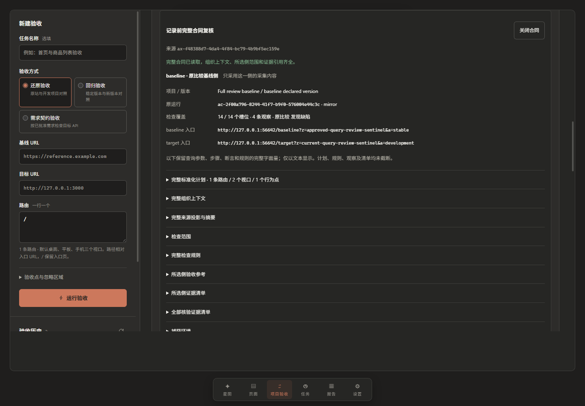
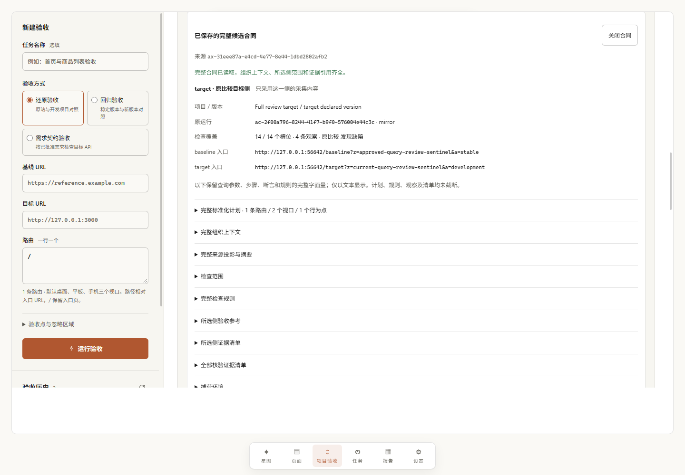
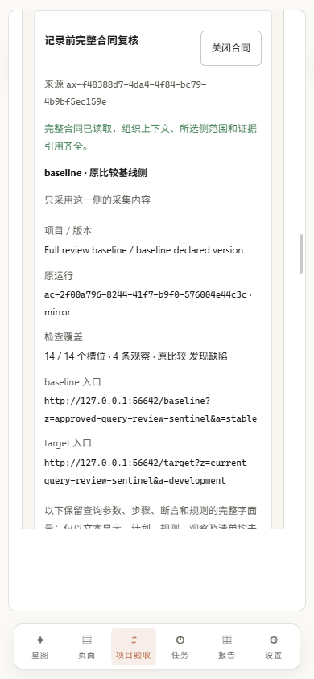
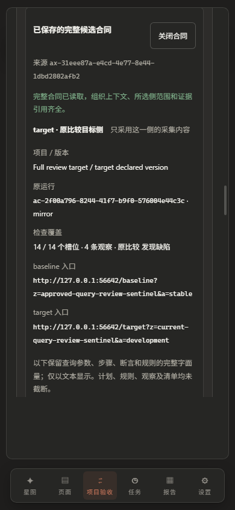

# D2 原件与发布核验

本目录对应 [Browser 完整复核与持久候选实施验收](../../acceptance-browser-candidates.md)，基准 head 为 `c170f503964601b7d125c2f902760c1235cc2e39`。ZIP、INDEX 和十三份便于阅读的原件副本已冻结；独立核验记录另行追加，不回写包内原件。

| 内容 | 数量 / 摘要 |
| --- | --- |
| 原件组 | 16 组，含全部开发失败、最终运行、独立审查与 D1 CI 原件 |
| 完整 ZIP | [complete-evidence.zip](complete-evidence.zip)，12,308,456 bytes |
| ZIP SHA-256 | `447639f06ba327c9beab2003a2a406758a827bb5cc495468d9cffcd3cc2ae09f` |
| 原始文件 | 1,088 份，21,938,299 inflated bytes；逐份 bytes / SHA / sourcePath 见 [INDEX.json](INDEX.json) |
| 最终命令 | 12 组，均 exit 0 / sourcesUnchanged:true / 557 项；每组 before / after 同 [final-sources.json](final-sources.json) |
| 发布方凭据模式扫描 | 21,938,299 bytes，0 高置信命中；不作为全面安全审计 |
| 独立复核 | [工作树核验](verification/working/verification.json)与[Git 暂存核验](verification/staged/verification.json)分别实际完成，各 22,829 checks / 0 failed |

## 快速核对

- [D2 原生 UI 检查](browser-checks.json)：13/13，两个候选，完整 review、独立确认、受控丢响应只读对账、ABA 和重启读取。
- [浏览器错误](browser-errors.json)：页面异常 0；仅允许精确注入的一条 POST 502。
- [来源前后摘要](source-file-digests.json)：全部原件最终 bytes / SHA 相同。
- [四视口布局](layouts.json)：desktop 1440×1000、mobile 390×844，深浅主题均无水平溢出。
- [独立收尾审查](finish-review.md)：本次局部扩展 `ship`；[设计继承核对](design-documentation.md)保留既有文档漂移，没有虚构设计稿或全局品牌变更。
- [D1 精确 run](d1-ci-run.json)与[原 artifact ZIP 摘要核对](d1-ci-archive-verification.json)：整轮 failure；完整日志、原 ZIP 和 163 个提取项均在完整包的 `d1-ci/` 组。
- [独立工作树命令](verification/working-command/command.json)与[核验日志](verification/working/verification.log)：逐份核对 ZIP、十六组原件全集、十三份副本和 557 项源码，并保留已知失败状态；高置信凭据扫描 1,265 files / 24,794,779 bytes / 0 findings。
- [独立暂存命令](verification/staged-command/command.json)与[暂存核验日志](verification/staged/verification.log)：实际通过 `git show :path` 读取公开包、索引、副本与全部 557 项源码；十二组运行摘要、十六组本机原件全集和凭据扫描均通过。核验记录本身随后追加，由发布方再核对本次全部暂存文件与工作树原字节，避免自引用。
- [D1 提取附件补核](verification/d1-extracted-byte-roundtrip.json)：嵌套原 ZIP 的 163 项与完整包内提取附件集合相同，逐份原字节一致。
- [首次发布文档检查](verification/docs-links/summary.json)：833 个目标 / 232 份 Markdown，exit 0，557 项源码前后不变。原命令中的输出目录保留实际运行时的路径；其后整体原字节移至独立 publication 目录，未改写原件。
- [最终发布文档检查](verification/docs-links-publication/summary.json)：843 个目标 / 232 份 Markdown，exit 0；此前 837 个目标的检查也保留在 verification/docs-links-final。独立 publication 目录保留原始命令、日志和源码摘要。

[独立核验脚本](verification/verify.py)使用 Python 标准库，分别读取工作树或 `git show :path` 暂存字节。它还核对本机 ignored 原件的十六组全集，因此需要本次保留的运行目录，不能把 clean clone 缺少原件当作归档损坏。核验脚本本身不写来源、Git 暂存区或公开证据。目录内 `.gitattributes` 关闭文本行尾转换，确保 CRLF 原件在 Git 中仍逐字节一致。

| 桌面深色，记录前复核 | 桌面浅色，已存候选 |
| --- | --- |
|  |  |

| 手机浅色，记录前复核 | 手机深色，已存候选 |
| --- | --- |
|  |  |

## ZIP 内部映射

`INDEX.originals` 是完整 entry 集合：`path` 为 ZIP 中路径，`sourcePath` 为封存时工作树内的原件路径。`readableCopies` 把本目录可读副本映射到包内原件；它们逐字节相同。所有路径只作证据定位，既有 ignored workspace 保留，不要求克隆仓库时具备那些本机绝对路径。

`integration/` 包含十二组最终命令，以及先前开发轮、两次 build 和 detector 启动记录。最终门禁清单严格由 `finalGates` 给出，不把开发轮 `sourcesUnchanged:false` 或未能启动的命令计为通过。

`ui-development-failure/` 保存首次 smoke 误取观察排序的失败现场；`api-development-failure/` 保存两条拒绝状态断言错误的日志；`d1-preparation-repro/` 保留原 Schema2 夹具启动失败。修正与最终成功均是独立组，未删除或覆盖失败。

`regressions/` 包含原 Acceptance console 17/17、forge、Console→Clone CDP、显式迁移 21/21、Spec baseline 13/13、managed execution UI 16/16、Browser Schema4 混合历史 19/19、managed preparation 27/27 的原件。所有浏览器门禁在本机串行运行。

本片候选操作没有批准、选用、dispatch 或 executor。ZIP 中 Spec 托管执行与既有混合历史来自独立回归，不是 Browser 候选获得了执行资格。父提交自身 CI 与本机 D2 结果也不替代 D2 提交自身的 Linux CI。
