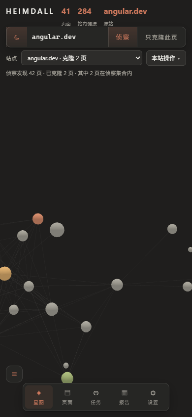
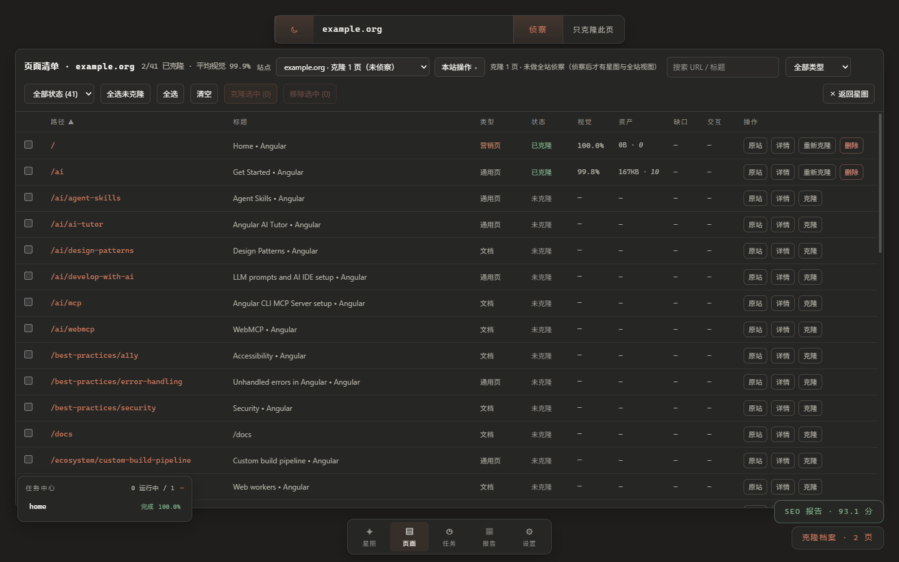
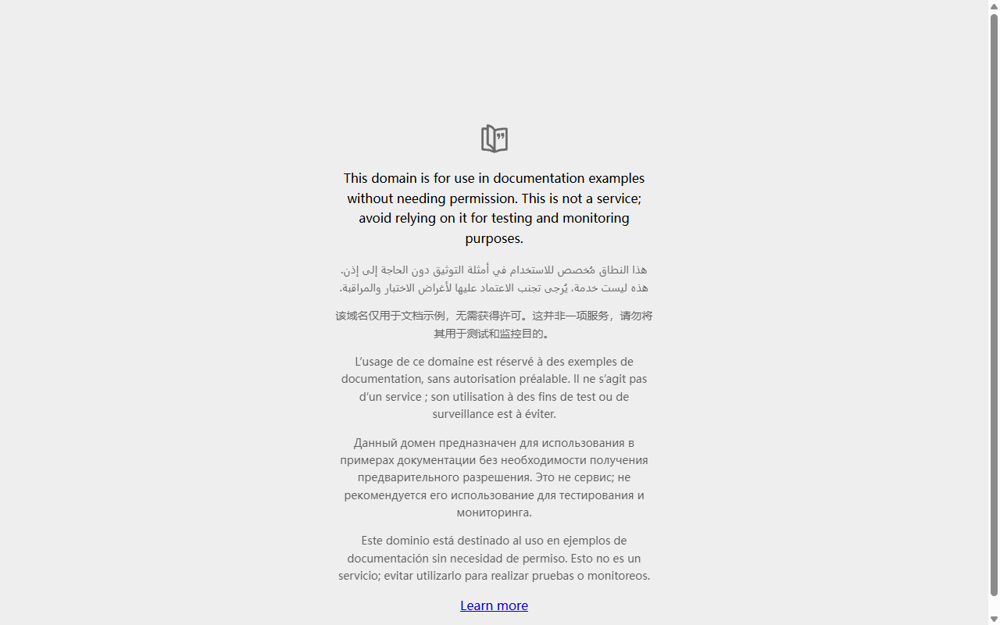
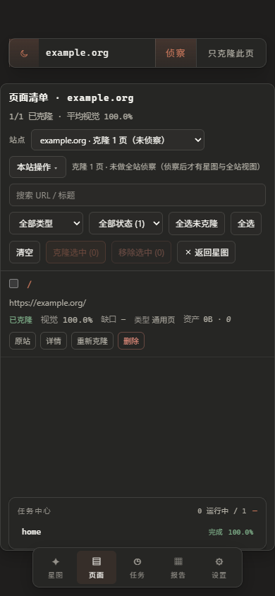
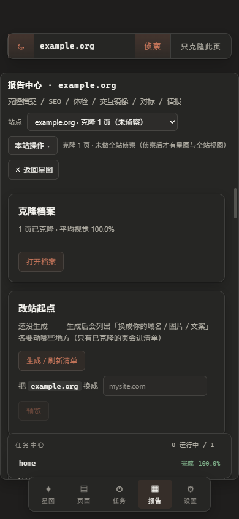
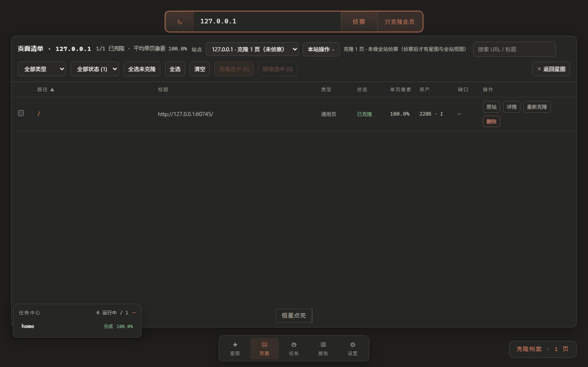
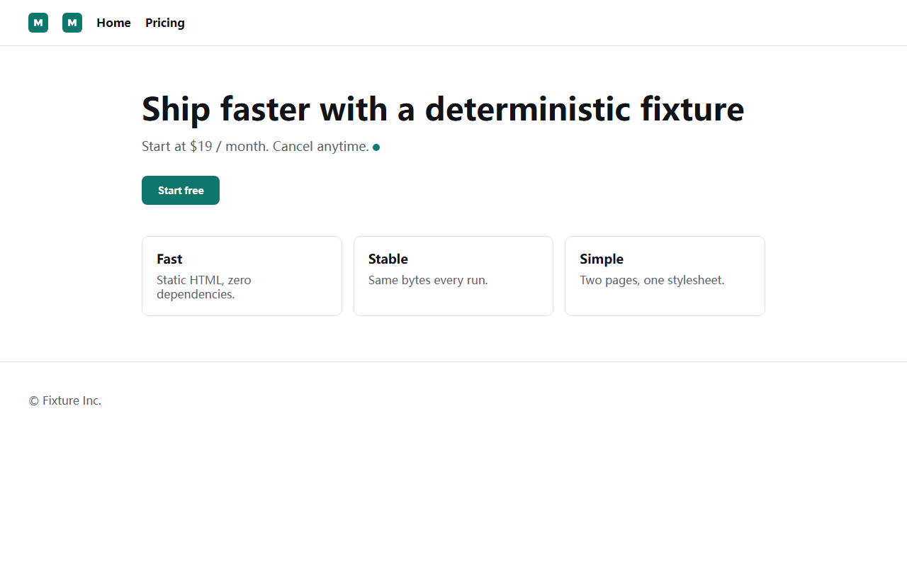
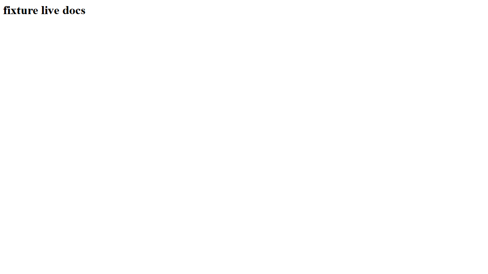

# Heimdall 全仓库价值与质量审查

- 审查日期：2026-10-14（香港时间）
- 审查基线：`main` / `575fe62`；第 1–6 节保留修复前证据与判断
- 复验对象：截至 2026-10-15 的未提交工作树，修复与限制见第 7 节
结论状态：**主要缺陷已修并经受控样本复验；最新全仓测试 694/694、语法检查 226 个文件通过；历史原件只读盘点后，最新隔离 v2 批处理在 407 个带克隆页中 2 页完整测量、3 页未测成、402 页待测。真实授权站点矩阵、断网/部署验收与历史全量复验仍待完成**

## 0. 当前结论

最值得投入的方向仍是**授权站点的可追溯快照、资产与视觉差异、前端接手验收**。这轮已补齐主要读数、URL 身份、导出门禁和认证边界，并跑通真实 CDP 控制台点击到克隆产物的闭环。现阶段可用受控样本证明流程可工作，不能据此承诺任意站点完整离线、历史高分仍有效或登录站全部交互可复刻。逐项结果和证据在[第 7 节](#7-修复复验与剩余边界)。

## 1. 决策摘要

Heimdall 目前最有实用价值的方向是：**为自有或获授权的网站建立可核验的视觉与资产基线，生成差异证据、前端迁移素材和回归验收包**。侦察、真实资产提取、页面清单、静态镜像、对比与接手材料已经连成可用链路。SEO 审计适合作为附加能力；可部署交互镜像适合作为实验性能力，暂不宜承诺任意站点、登录态、完整离线交互都可用。

修复前最大问题不是模块数量或界面外观，而是**成功读数与交付事实不完全一致**：长页缺失仍可得满分，不同 URL 可被折叠，验证只覆盖部分页面，离线门禁和 SEO 门禁在特定失败状态下放行。另一组风险涉及交付目录清理、登录态数据进入 HAR、公开静态产物，以及控制台跨站串数据。修复后的状态见第 7 节。

建议对外表述为“**可追溯的网站快照与还原验收工作台**”。避免“任意整站高保真”“静态保真度天然 100%”“完全离线可用”等绝对说法，直到覆盖率、分数、认证和交付门禁都有独立验收。

| 方向 | 现在能提供的价值 | 近期定位 |
| --- | --- | --- |
| 授权站点的前端接手、改版与视觉回归 | 页面结构、资源、冻结快照、差异、改站清单可交给工程师复核 | **主线**：先把证据和覆盖率做可信 |
| 站内技术 SEO 审计 | 规则、报告、基线差异已有实现 | **辅线**：激活真实目标和有效基线后再称“回归门禁” |
| 交互镜像与离线部署包 | 部分站点的脚本、资源和 HAR 回放可形成可运行包 | **实验线**：逐站验收认证、隐私过滤和离线失败判据 |
| “贴网址自动复刻并直接上线” | 目前缺跨站普适性、登录态交付和可信评分证明 | 暂不作为产品承诺 |

外部能力参照：[Screaming Frog 官方文档](https://www.screamingfrog.co.uk/seo-spider/tutorials/site-architecture-crawl-visualisations/)已有爬取与 3D 站点结构图，[Playwright 官方文档](https://playwright.dev/docs/test-snapshots)已有截图基线比较，[Apify 的网站内容爬虫](https://apify.com/apify/website-content-crawler/api)已有网页内容提取。由此推断，Heimdall 更值得把页面身份、覆盖率、视觉缺口、资产来源与可交付的接手证据串成一个可复核流程。这是产品方向判断，尚未经过付费意愿或用户访谈验证。

## 2. 审查范围、方法与边界

本次盘点了 259 个受 Git 跟踪的文件，其中 `core/src` 100 个、`core/test` 70 个、`console/src` 19 个。按入口与调用链检查了侦察/队列、捕获/构建、评分/验证、SEO、交互镜像/导出、任务持久化/引擎路由、控制台和文档；对高风险结论做了源码交叉验证、纯离线样例或真实浏览器复现。**“全仓库审查”表示覆盖各子系统与交付面，不表示逐行证明每个模块没有缺陷。**

| 检查 | 结果 | 能证明什么 |
| --- | --- | --- |
| `pnpm -C core lint` | 226 个文件语法检查通过（2026-10-15） | 模块可解析；不证明行为正确 |
| `pnpm -C core test` | 694 通过、0 失败（2026-10-15） | 当前工作树的行为回归；下文未关闭边界仍需真实站点验收 |
| `pnpm -C core smoke` | 两页本地 fixture 通过 | 离线捕获到产物的基本链路可工作 |
| `pnpm -C console build` | 通过 | 控制台可构建；不证明切站状态正确 |
| core 依赖审计（npm 官方 registry） | 1 个 moderate、0 个 high/critical | 需跟踪传递依赖；不等同目前存在可触发漏洞 |
| 真实 CDP 浏览器 | Chromium 远程调试端口 `9223`，Playwright `connectOverCDP` | 实际操作控制台、等待任务、打开产物，并在桌面/390px 手机视口检查 |
| 专项离线复现 | 评分裁切、SEO 损坏基线、离线 `--strict` | 确认读数或门禁错误；没有对真实数据执行破坏性操作 |

**未验证**：没有重爬仓库里的所有真实站点；没有拿真实登录账号跑完整导出、外部网络部署或断网表单/API 回放；没有对交付目录误删风险执行真实删除。现有站点评分只是历史快照，本报告不重新背书。截图只支持可见布局判断，不等同完整无障碍验收。用户已有的 `.claude/` 未跟踪目录没有改动；审查用 `example.org` 产物保留在被忽略的 `core/workspace/` 下。

### CDP 操作链与截图

1. **进入星图，健康。** 打开 `:5173`，选中 `angular.dev`；桌面和 390px 首屏的星图有实际 canvas 内容，移动端没有页面级横向溢出。图：`evidence/mobile-atlas-fresh.png`。
2. **发起单页克隆，成功。** 在当前界面输入 `https://example.org/`，点击“只克隆此页”；`POST /api/forge` 返回任务 `f001`，SSE 经过 1/6 至 6/6 并结束。该页被显示为视觉 100.0%；这是本页读数，不代表跨站普适性。
3. **切到页面清单，失败。** 标题已是 `example.org`，表格却显示 Angular 的 41 页、`2/41 已克隆` 与 99.9% 平均视觉；`/api/pages/example.org` 实际只有 1 页。重新用站点选择器选择 `example.org` 后恢复 `1/1`。图与[原始接口/DOM 记录](evidence/example-org-cross-site.json)：`evidence/example-org-cross-site.png`。
4. **打开实际产物，成功。** `/static/example.org/pages/home/clone/index.html` 为 200，标题 `Example Domain`，内容可见；站点档案、对比页、评分 JSON、情报 Excel 入口也返回 200。图：`evidence/example-org-clone.png`。
5. **手机视口检查，局部可用。** 页面、任务、报告视图没有整体溢出；页面行操作高度约 25px，报告中的产物入口位于长滚动下方。图：`evidence/mobile-pages.png`、`evidence/mobile-reports.png`。控制台没有 Vue `pageerror`；未生成的可选产物请求产生 404 噪声。

## 3. 修复前优先缺陷清单

分级含义：P1 为可能造成错误交付、数据暴露、误删或关键流程误操作；P2 为准确性、覆盖率和体验缺陷。证据类型分为“真实流程”“离线复现”“源码确认”；标为“风险推断”的影响尚未用真实用户数据触发。

### P1：先让结果与交付可信

| 编号 | 证据、现象和影响 | 修复方向与验收 |
| --- | --- | --- |
| P1-01 评分忽略缺失的整段页面 | `core/src/verify/compare.mjs:16-32` 只取两图共同宽高，分母也是共同区域。离线复现：原图 10×100、镜像 10×10，重合部分相同仍得 `score=1`，仅另记 `heightDelta=90`。现有 `apify.com/ideas` 移动端高度相差 5616px 却报 98.69%。**读数失真。** | 将缺失宽高计为差异或独立硬门槛；在报告同时展示源图/镜像尺寸和覆盖比例。验收：10×100 vs 10×10 不得评 A/100%，长页明显缺失必须失败。历史分数须标旧口径并重算。 |
| P1-02 不同 URL 被折叠成同一页 | `core/src/url-canon.mjs:80-85` 页名忽略 query，路径中 `/` 和 `-` 都会变成 `-`，且截断 60 字符；`core/src/queue.mjs:56-60` 按页名去重。现有 apify/astro 星图可见不同 URL 撞名，队列只留一条。**整站覆盖率被高估。** | 定义 URL 规范化规则，用稳定哈希或映射表保证不同页面有不同目录名；迁移旧 `pages/`、队列、链接映射和报告索引。验收：query、分隔符、长路径碰撞样例均保留且能互相导航。 |
| P1-03 控制台新站混入旧站页面 | CDP 真实复现见上方步骤 3。`console/src/Atlas.vue:833-840` 的 `forgeSingle()` 只改 `host`，未走 `pickSite()` 清理旧 `nodes`；`Atlas.vue:279-319` 又按路径将新站 `/` 匹配旧 Angular 首页。`Atlas.vue:242-256` 删除请求使用当前 `host` 加行页名，**误删新站 `home` 是源码风险推断，未实际点击删除。** | 切站统一调用一条站点上下文重置路径，异步响应带 host/代次校验；禁止跨站行操作。验收：从站 A 克隆站 B 首页后直接进页面清单，只显示 B 的 1 页；旧行不出现、不可操作。 |
| P1-04 重启后任务历史串线 | `core/src/engine-server.mjs:423-425` 进程重启后从相同短 ID 重新编号；`core/src/jobs/store.mjs:48-50` 冲突更新保留旧 URL/创建时间，事件继续按 ID 聚合。只读查询现有库：`f001` 横跨五天，有 8 条 `exit`。**任务来源、时间和结果不能信。** | 使用跨进程唯一 ID；存量记录保留证据后按启动代次/时间修复或隔离。验收：连续重启后任务 ID 唯一，历史事件只属于对应任务。 |
| P1-05 `--out` 防护可放行递归删除 | `core/src/live/export.mjs:70-74` 用字符串 `startsWith(DELIVERABLE)` 判断，再 `rmSync(OUT, recursive:true)`；交付根目录本身和同名前缀兄弟目录均可通过。**未执行破坏性复现。** | 用解析后的路径和 `relative()` 判断严格子目录，拒绝根目录、兄弟目录、符号链接逃逸；先写临时目录，验证通过后原子替换。验收：危险路径测试只返回错误且既有文件逐字节不变。 |
| P1-06 登录态 HAR 和静态工作区有暴露面 | `core/src/live/har.mjs:17-34` 去掉敏感头，却保留完整 URL query 和响应正文；`core/src/live/export.mjs:190-193` 写入交付包。`core/src/engine-server.mjs:773` 的 token 门禁只覆盖 `/api/*` 与 `/px/*`，`/static/*` 及静态工作区路由在远程绑定时仍可读。**真实私密数据外发未演练，属于有条件风险。** | 登录态站点默认禁导出 API 正文，清洗 URL/query/body 并提供扫描报告和显式放行；统一私有产物鉴权，公开导出采用白名单。验收：带伪凭证/PII 的 fixture 在包与无 token 静态响应中不可见。 |
| P1-07 交互镜像认证协议不闭环 | `core/src/live/serve.mjs:130-146` 代理只转发少量头，不传 Cookie；使用 Node `ServerResponse` 没有的 `append` 写 `Set-Cookie`，因可选链而静默失效。`serve.mjs:157-164` 对 POST 也先查本地快照；`core/src/engine-server.mjs:773` 的引擎 `/api/*` 判断早于镜像域识别（约 :1426）。**登录、表单和站点 API 在独立包或镜像域可能失败；源码确认，未用认证站全链验证。** | 先按 Host 分流引擎/镜像请求；独立包按方法路由，正确转发/重写 Cookie 与多值 Set-Cookie；补真实服务器集成测试。验收：Cookie 登录后 GET、POST/API、重定向与登出在镜像域和独立包都能往返。 |

### P2：扩大覆盖并消除假绿

| 编号 | 证据、现象和影响 | 修复方向与验收 |
| --- | --- | --- |
| P2-01 `verify --all` 默认只测 10 页 | `core/src/verify/verify.mjs:34-36,54-56`；阈值只看已测页均值（:145-153）。命令名容易让人理解为“全站通过”。 | 显式称 `--sample 10` 或默认遍历全部；汇总写目标总数、已测/未测、失败/跳过和最低覆盖率。验收：11 页时默认检查 11 页；缺测不能通过全量门禁。 |
| P2-02 离线 `--strict` 漏掉可观察缺口 | `core/src/live/health.mjs:203-215` 将 `_next/image` 等记为 `dynamic`、站外静态资产另计；`core/src/live/export.mjs:198-201,326-329` 只用 `assets.unresolved` 决定退出码，忽略 `dynamic`、`externalAssets`、`liveMissing` 和缺页链接。纯离线样例已复现“实际资源 404，strict 仍通过”。 | 为“离线可用”定义分项阻断矩阵与可解释例外；用启动的独立包断网探测所有关键资源。验收：任一必需资源 404 或镜像页缺失时 strict 非零退出。 |
| P2-03 SEO 损坏基线可被覆盖为首次运行 | `core/src/seo/audit.mjs:248-280` 解析失败后 `baseline=null`；`core/src/seo/baseline.mjs:134-135` 把 null 判成 firstRun/ok，随后写回原路径。纯离线样例已复现。 | `--require-baseline`/`--fail-on-regression` 下解析失败必须前置失败且不改文件。验收：损坏 JSON 的校验码和内容运行后不变，退出码非零。 |
| P2-04 每日 SEO workflow 当前没有真实目标 | `config/seo-targets.txt` 全是注释，`config/seo-baseline/` 无站点基线；`.github/workflows/seo-gate.yml:58-70` 为空时通知“无事可做”。2026-10-13 定时运行虽成功，但日志确为门禁无事可做。 | 若定位为演示则在 README 标“未启用”；若称回归门禁，至少配置授权测试站与受版本控制的基线，空目标改成显式 skipped/失败策略。 |
| P2-05 响应式升级异常可能留下改坏的产物 | `core/src/crawler/responsive-upgrade.mjs:70-93` 先原位重建，再验证；异常仅记失败，回退重建退出码也未检查。**源码风险，未实际破坏产物。** | 在候选目录构建和验证，通过才切换；异常恢复旧版本并再验。验收：人为让构建/验证失败后 clone 校验码与分数保持原状。 |
| P2-06 同源判断使用字符串前缀 | `core/src/crawler/recon.mjs:97`、`core/src/seo/collect.mjs:59,64,77,101` 对 URL 使用 `startsWith(origin)`；类似 `example.com.evil` 的域名可被误判。 | 解析 URL 并比较 `.origin`，补相似域名、大小写、默认端口与重定向用例。 |
| P2-07 队列失败不稳定地反馈到调用方 | `core/src/queue.mjs:132-137,245-295` 的结束逻辑可能在页面或后处理失败后仍正常退出；SSE 失败后轮询（:169-183）缺统一终止期限。 | 汇总失败项并设置非零退出码，轮询使用截止时间/取消信号；验收：故意让一页失败，任务和 CLI 均明确标失败且保留断点。 |
| P2-08 控制台加载态与文档结构 | 跨站选择 apify 时页面清单短暂显示 `0/122` 后变 `121/123`；`console/src/PagesView.vue:127` 未承载加载状态。`console/src/DetailDock.vue:330-337` 的表格有直属 `<tr>`，Vite 警告无 `<tbody>`；部分可选产物 404 作为控制台 error。 | 切站期间显示明确加载态并禁用行操作，添加 `<tbody>`；可选产物查询避免产生无意义错误。验收：慢网络切站不显示旧站/假零计数，浏览器控制台无相关警告。 |
| P2-09 手机操作密度 | 390px 页面清单可用但行按钮实测 38×25px，报告入口在长滚动下方；`console/src/ui.css:355` 是按钮样式。截图见上。 | 为高频动作增加易触达尺寸和间距，报告首屏放主要产物入口或固定局部导航；用 390px、触控和键盘复核，不只看无遮挡。 |

## 4. 文件治理与文档更新

这里的“清理”是**建议**，本轮没有删除历史证据或运行数据。尤其 `core/workspace/`、`core/deliverable/`、日志和旧报告应先盘点用途、容量与引用，再决定归档或回收。

| 位置 | 当前问题 | 建议动作 |
| --- | --- | --- |
| `README.md:61`、`docs/guide/README.md:85` | 根 `pnpm install` 不会安装 `core/` 与 `console/`：根 `package.json` 无工作区配置或依赖，两个子包各有 lockfile；Dockerfile 本身分别安装两者。 | **立即更新**新机步骤：分别 `pnpm -C core install --frozen-lockfile`、`pnpm -C console install --frozen-lockfile`，或正式引入 workspace 后统一命令。 |
| `USAGE.md:23-30`、`PRD.md:74-75,133` | 称“点任意星球自动锻造”“锻造内环”，当前点星只打开详情，克隆需显式操作；PRD 的“静态保真度天然 100%”与实测不符。 | **立即改口径**并按当前 UI 重写三分钟上手；保真度必须标算法、视口、样本与缺口。 |
| `PRD.md:165`、`README.md:197-198`、`RISKS.md:13-17` | 登录后页面一处写禁区，一处写获授权可复用，边界相互冲突。 | **统一产品边界**：仅自有或明确获授权内容；认证捕获、分发和代理权限分别说明。 |
| `README.md:53`、`docs/guide/01-architecture.md:103` | “同命令跑两次结果一致”过度绝对；原站、会话、时间及根级元数据都可变化，`docs/DELIVERY.md:120-124` 自己说明元数据变化。 | 改为“固定输入与环境下处理流程可复现”，用 `changes.json`/`checksums.json` 做结构化比较。 |
| `docs/guide/03-features.md:138-141` | 把全部 JS 动效/滚动揭示写成静态定格；`core/src/crawler/motion-replay.mjs` 已支持部分揭示与 `Element.animate()` 重演。 | 按 CSS 原生、已重演、仅交互镜像、尚不支持四类更新说明。 |
| `VISUAL-SYSTEM.md:184` | 指向不存在的 `SitePicker.vue`；实际为 `console/src/SiteBar.vue`。 | 修组件名和站点状态所有权描述。 |
| `HANDOFF.md:4`、`RISKS.md:35` | 前者链接不存在的 `docs/W0-W16-REPORT.md`，后者 `ROADMAP.md` 相对链接断链。 | 修到实际 `docs/archive/` 和 `docs/ROADMAP.md`；新增文档链接检查。 |
| `docs/ROADMAP.md`、`HANDOFF.md` | ROADMAP 声称只列未做事项，却有大量 `[x]` 历史；HANDOFF 已 2734 行，以 2026-10-08 的“当前快照”开头。 | **重整**为简短当前状态/开放事项入口；逐期过程移 `docs/archive/`，保留可追溯引用。 |
| `docs/REVIEW-HANDOFF.md` | 2026-10-13 的审查快照，写 506 条测试、旧行数和旧排序；不能与本报告一起当最新事实。 | 标“历史快照”，在页首链接本报告；已关闭项继续保留来源，不照搬成新待办。 |
| `core/deliver-plan.json` | 被 Git 跟踪的 2026-10-10 运行期清理预览；`core/src/audit/deliver-prune.mjs` 会写该路径。 | 核对消费者后取消跟踪并忽略；先归档快照，**不要直接删除用户的交付包**。 |
| `core/pnpm-lock.yaml` | 当前锁定 `exceljs@4.4.0 -> uuid@8.3.2`；官方 registry 审计报 1 个 moderate。Playwright 1.63.0 和 pixelmatch 7.2.0 有新版本，其中后者跨主版本。 | 先确认公告影响路径，再做最小依赖更新；pixelmatch 升级必须重跑评分口径与历史分数对照，避免悄悄改变 A/B/C 判定。 |
| `clone-heimdall.cmd:14-34` | 等待达到轮数后仍会落到 ready/start；HTTP 错误未作有效健康判定，固定打印 thordata 档案地址。 | 改成明确的启动/超时失败状态，动态生成有产物才显示的链接。 |
| `core/src/crawler/fullshot.mjs`、`repair-css-refs.mjs` | 面向旧产物修复，常规主链路不调用。 | 标适用产物版本，移入维护工具区；确认无调用方后再决定保留。 |

**不建议删**：`docs/archive/` 的阶段证据；`docs/guide/assets` 的交互 HTML、PNG 与 source JSON 有明确再生关系；`core/workspace/_shots`、`_tour`、`_runs` 是忽略的本机证据。它们可做容量盘点与冷归档，但不应以“看起来冗余”为由直接清除。根 `pnpm-lock.yaml` 的 importer 虽为空，若未来整成 pnpm workspace 可复用，也不宜单独删除。

## 5. 重构边界与能力建设

1. **先定义可信验收契约。** 每份报告同时给出发现页面数、计划克隆数、实际克隆数、验证数、未测数、视口、原/镜像尺寸、离线资源/链接缺口和失败原因。分数应是这些证据之上的摘要。维护评分版本，避免新旧 `score.json` 混读。
2. **统一 URL 身份。** 规范 URL、页名、磁盘路径、atlas 节点和队列 ID 现在由不同规则联系。引入唯一映射与迁移工具，再改队列、链接器和控制台；避免只修 `pageNameOfUrl()` 却让旧产物失联。
3. **把站点状态切换收成一条路径。** `Atlas.vue` 约 120 KB，既管站点/视图，又管任务 SSE、表单、报告。优先抽 `useSiteContext`（站点切换和异步代次）与 `useEngineTask`（重复的任务订阅），并用跨站 E2E 守卫；不建议仅为缩短文件而一次性拆所有视图。
4. **分离引擎路由责任。** `engine-server.mjs` 约 88 KB；先把镜像域识别、鉴权、静态资源服务抽成可测试的边界，保留并发槽/任务状态机的现有整体性。任务 ID 改唯一后再处理历史库迁移。
5. **交付包用候选构建与真实服务验收。** 在临时目录生成，执行静态扫描、离线服务探测、认证/请求方法测试，通过后替换目标包。响应式升级沿用同一“候选产物”机制。
6. **扩大语料而不滥用历史高分。** 选 SSR、CSR、分页/query、长页、Canvas/WebGL、授权登录、站外 CDN 的小型受控站点矩阵；每类至少一条“故意缺失内容/资源”的反例测试。现有两页 smoke 负责回归，不代表普适性。

建议按以下批次推进，后一批以明确验收结果为前提：

| 批次 | 目标 | 退出条件 |
| --- | --- | --- |
| A. 交付保护 | P1-03、05、06、07：串站、危险目录、私有数据、Cookie/Host 路由 | 错站操作不可达；危险 `--out` 不改文件；伪凭证不入包；认证镜像 GET/POST 闭环通过 |
| B. 可信读数 | P1-01、02、04 与 P2-01、02、03、04 | URL 不丢页；缺失高度不能高分；全量覆盖率可见；损坏基线/关键离线 404 都红；任务历史不串线 |
| C. 稳定性与体验 | P2-05 至 09，启动脚本与文档 | 升级失败旧包不变；切站无假读数；手机操作更易触达；新机照 README 可启动 |
| D. 产品扩展 | 授权站点样本矩阵、SEO 真实基线、交付价值验证 | 在明确样本与限制内，接手者能用包重现问题、比较改版并完成回归验收 |

## 6. 复核与交接说明

- 现有 `docs/REVIEW-HANDOFF.md` 是 2026-10-13 的审查快照，提供其他待办线索；本报告按 2026-10-14 的代码与实测重新定优先级。旧待办若未在本轮复现，不在上表中当作新的已证实缺陷。
- 审查证据副本在本目录 `evidence/`；原始截图和 `example.org` 产物仍在 `core/workspace/_runs/repo-audit-20261014/` 与 `core/workspace/example.org/`，均被 Git 忽略。本节记录修复前的端口与产物状态；当前复验状态以第 7 节为准。
- 上表是**修复前**诊断与执行顺序，不应脱离第 7 节当成当前缺陷清单。

## 7. 修复复验与剩余边界

### 7.1 真实浏览器与统一验收

本轮在专用 Edge CDP `:9223` 上实测了从控制台到克隆产物的完整操作链。隔离临时工作区内启动受控双页站点与引擎，在控制台输入带非默认端口的 `http://127.0.0.1:<port>/`，**未拦截** `/api/forge`：按钮发起真任务、六阶段完成、页面清单显示 `1/1`；打开生成的 `clone/index.html` 得到 HTTP 200，页面标题与主标题正确，图片加载，未捕获页面异常为 0。结构化记录在 [cdp-real-forge.json](evidence/cdp-real-forge.json)，界面与产物见下图。首次运行还揭示控制台把源站端口错当工作区主机名，导致成功后空清单；[修复前截图](evidence/cdp-pre-fix-host-mismatch.png)和日志已保留，随后统一主机名规则并复验通过。

2026-10-15 用当前构建再次通过**脚本自启动 Chromium 远程调试端点并以 Playwright `connectOverCDP` 接入**：从控制台点击“只克隆此页”、等待真实引擎任务、打开静态产物，得到 `taskStatus=done`、产物 200、图片加载且 `pageErrors=[]`。见[最终复跑记录](evidence/cdp-final-20261015/cdp-real-forge.json)、[控制台截图](evidence/cdp-final-20261015/cdp-console-forge.png)和[产物截图](evidence/cdp-final-20261015/cdp-clone-artifact.png)。该脚本覆盖的是单个带非默认端口的源站；同 hostname 的双端口并存隔离由独立 HTTP 集成测试覆盖。这仍是隔离的本地受控站点样本。

另外用 Playwright 启动的真实 Chromium 跑了无 Token、同主机 Token 和跨主机 Token 控制台 E2E。Token 主入口使用 60 秒、一次性、绑定站点的票据：同主机从 `/api/mirror-launch` 原生跳转；控制台与 API 主机名不同时，以带 Token 请求头的 `/api/mirror-ticket` 领票后打开镜像子域。两种 Token 流程均到达 SPA 的 `/docs/`，页面显示 `fixture live docs`，最终地址没有票据或 Token；见[同主机记录](evidence/token-spa.json)、[跨主机记录](evidence/token-cross-host-spa.json)及下图。HTTP 集成测试还确认票据不能重放、引擎会话 Cookie/Token 不传到源站，独立包回源 HTML 的表单可在 Chromium 中提交并完成 Cookie、重定向往返。安全复核后，引擎主域的 `/lm/` 前缀入口已停用，独立交付包自己的 `/lm/` 入口仍保留；这些受控夹具**不能替代**外部获授权登录站的人工会话验收。本次 Token 补测的隔离 Edge CDP 启动命令被自动执行策略拒绝，因此这部分如实标为 Chromium E2E，不计入上述 CDP 证据。

新增恶意源站文档的真实 Chromium 回归：[结构化记录](evidence/chromium-document-isolation.json)确认组件预览、捕获 DOM、静态克隆均处于不透明 origin，不能读取引擎 API；无 Token 的 `Origin:null` 简单 POST 收到 403。伪造 Host 的 GET/POST 收到 421，`/px` HTML 禁脚本，SVG/XML/XHTML 顶层导航触发下载。375px 克隆仍选择手机变体；对比页保留双向滚动、query 参数和旧报告兼容，内联 JSON 注入不执行。正式反向代理使用公开域名时需显式配置 `HEIMDALL_TRUSTED_HOSTS`；独立包与其他报告页仍须按部署环境验收。

控制台报告页现有验收摘要，分别显示侦察发现、计划与实际克隆、当前产物对应的 v2 完整测量、未测与资源缺口，并将缺失/过期证据标明。受控浏览器检查了 `angular.dev` 和 `apify.com` 的旧产物状态、桌面与 390px 版式、刷新、证据 JSON 新标签打开和 Markdown 下载；`angular.dev` 的两项 404 被明确显示为未生成，不能误读为通过。见[交互记录](evidence/acceptance-summary/browser-checks.json)、[下载样例](evidence/acceptance-summary/apify-acceptance-download.md)和[手机截图](evidence/acceptance-summary/angular-mobile-evidence.png)。

| 检查 | 修复后结果 | 范围 |
| --- | --- | --- |
| `pnpm -C core lint` | 226 个文件语法通过（2026-10-15） | 语法，不是行为证明 |
| `pnpm -C core test` | 694 通过、0 失败（2026-10-15） | 当前工作树的行为回归；仍不替代真实授权站点矩阵 |
| `pnpm docs:links` | 26 份当前文档的 115 个本地目标均存在（2026-10-15） | 不扫描归档及运行期目录；外部 URL 可用性不在此门禁内 |
| `pnpm -C core smoke` | 通过；侦察 2 页、视觉与 DOM 样本均 100.0%、SEO 77 分、离线包资源缺口 0 | 本地受控站点，不代表任意公网站点 |
| `node core/scripts/smoke-upgrade-failure.mjs` | 通过；注入构建失败后原克隆字节不变 | 候选发布与回滚 |
| `pnpm -C console build` | 通过 | 3D 图谱产物仍有约 1.4 MB 大 chunk，后续需按实际加载性能评估 |
| Edge CDP 实测 | 控制台真克隆 + 产物打开 | `cdp-real-forge.json` 与截图在 `evidence/` |
| Chromium E2E | 普通及两种 Token SPA 流程通过 | 同主机/跨主机 JSON 与截图在 `evidence/`；Token 补测未使用 CDP |
| 自启动 CDP 真克隆 | 2026-10-15 当前构建得到 `done`、产物 200、图片加载、0 页面异常 | [JSON](evidence/cdp-final-20261015/cdp-real-forge.json)、[控制台截图](evidence/cdp-final-20261015/cdp-console-forge.png)、[产物截图](evidence/cdp-final-20261015/cdp-clone-artifact.png)；双端口并存隔离另由 HTTP 集成测试覆盖 |
| Chromium 安全与恢复 E2E | 文档隔离、旧克隆导出隔离、站点删除→恢复、交付包隔离→恢复均通过 | 受控恶意 HTML、HAR 和临时数据根；旧包须重新导出 |

### 7.2 原缺陷与二次发现状态

| 编号 | 当前状态 | 修复证据与未关闭部分 |
| --- | --- | --- |
| P1-01 | **代码修复，最新指纹完整复验 2 页；其余历史待重算** | 缺失高度/宽度计入像素差异；`verify.json` v2 记录尺寸、覆盖率和缺失像素。2026-10-15 隔离批处理仅 `angular.dev/ai` 90.55%（B）及 `home` 94.80%（B）完成三视口测量；`apify.com/ideas`、`jobs`、`apify-instagram-scraper` 均因渲染未收敛而没有有效总分。此前 Apify 的 79.81%、90.74% 和长页 88.0% 属于旧指纹阶段的历史测量，不能替代最新结果。另有 402 页未尝试，原工作区旧记录未改写。见[最新隔离复验](evidence/historical-v2-final-20261015/README.md)和[先前快照](evidence/historical-v2-batch/README.md)。 |
| P1-02 | **新任务修复，历史已只读盘点** | query、分隔符与长路径得到稳定不同页名；旧 manifest 的原目录仍可解析；队列、链接与控制台按新身份衔接。旧 atlas 中确认 apify 与 astro 各有一条 query URL 因旧同名规则没有对应克隆；缺失内容仍须隔离重锻。 |
| P1-03 | **修复并经 CDP 复验** | 切站重置上下文、异步响应代次校验、跨站行操作守卫；跨站 fixture 与本轮带端口真克隆均显示正确清单。 |
| P1-04 | **新任务修复，旧记录保留** | 任务 ID 改 UUID，存储层拒绝不同身份覆盖，跨重启测试通过。旧 `f001` 等曾混写的历史行未改写，不能用于精确历史统计。 |
| P1-05 | **修复** | 输出路径严格限制在交付目录的子目录，符号链接/同名前缀反例受拒；strict 验收失败时旧包字节保持，候选目录通过后才切换发布。 |
| P1-06 | **默认保护与受控测试通过** | HAR 默认剔除带认证或敏感 query、pathname、文本正文的条目，排除记录只留脱敏路径；`/static/` 与工作区静态别名需 Token；伪凭证与敏感路径导出夹具通过。未知业务路径、二进制内容和克隆页面正文仍需逐站检查，不能概括为任意私密数据均已识别。 |
| P1-07 | **受控 HTTP 与 Chromium 通过** | 镜像域先于引擎 API 分流；GET/POST、Cookie、重定向、登出及独立包往返测试通过。Token 主入口通过一次性票据进入独立子域，SPA 保持原路径；同主机、跨端口、跨主机控制台覆盖左键和原生新标签。静态沙箱资源的会话 Cookie 已改为 `SameSite=None; Secure`，图片可加载且沙箱脚本不能读写引擎 API。独立包回源表单已用浏览器提交复验；引擎 `/lm/` 已关闭，外部认证站、自定义 JS 提交、HTTPS 反代仍未验收。 |
| P2-01 | **修复** | CLI、引擎 API 和控制台全站体检均默认不带页数上限；显式 `maxPages` 仍为抽样。摘要写目标/完整测量/未测，缺测不通过，11 页夹具与 API 集成测试通过。 |
| P2-02 | **修复受控门禁** | strict 阻断动态资源、站外静态资产、缺页/链接与实际服务 404；新补扫 HTML `<style>` 块及 `style` 属性内 CSS 的 `url()`、`@import`，缺失资源计入 `unresolved` 并阻断。控制台导出固定 strict，失败候选与旧正式包分离，UI 仅在零阻断时称可交付。旧导出包不自动追溯合格；运行时脚本请求仍须逐站验收。 |
| P2-03 | **修复** | 基线解析失败在门禁模式下前置报错，不覆盖损坏文件；字节不变回归测试通过。 |
| P2-04 | **策略明确，尚未启用真实目标** | 未有授权目标与版本控制基线，定时运行已停用；手动空目标明确失败，README/配置文件标明未启用。录入授权目标后才能宣称 SEO 回归门禁有效。 |
| P2-05 | **修复** | 响应式升级在候选目录构建、验证与评分，达门槛才发布；失败回滚页面和证据，故障注入确认旧克隆字节不变。 |
| P2-06 | **修复** | sitemap、浏览器 BFS、SEO 链接收集和历史 atlas 复用均按 URL origin 比较；相似前缀双站点 fixture 通过。 |
| P2-07 | **修复** | 页面/后处理失败合并为任务失败与非零退出；SSE 等待有截止时间与取消信号，保留续跑断点；定向测试通过。 |
| P2-08 | **修复并浏览器复验** | 切站加载态与行操作守卫、表格 `<tbody>`、可选产物探测已调整；控制台 E2E 无页面异常。 |
| P2-09 | **修复并浏览器复验** | 390px 行操作高度达到 44px，报告主要入口在手机首屏；控制台 E2E 检查尺寸。 |
| S-01 不受信页面获得引擎主域权限 | **修复并经 Chromium 复验** | 关闭引擎 `/lm/`；工作区 HTML 使用 CSP sandbox，活跃 XML/SVG 限制为下载，写接口校验来源且请求 Host 有信任表。组件事件处理器与无 Token 的 `Origin:null` POST 被浏览器/服务端边界阻断。独立交付包和正式反代需单独验收。 |
| S-02 对比页内联 JSON 注入 | **修复并经 Chromium 复验** | 内联 JSON 对 HTML 终止字符编码；恶意 `pageType` 未执行脚本，对比页双向滚动与 query 链接仍工作。 |
| S-03 捕获跨源重定向 | **修复并经隔离测试复验** | 导航后和写盘前核对最终 origin，跨主机/端口重定向不产生误标站点产物；直接捕获遇到 `http→https` 或 `www→裸域` 规范跳转会拒绝，需先侦察并以落地 URL 重试。 |
| S-04 独立包旧克隆执行源站事件处理器 | **修复新构建与重导出副本，旧包待处理** | 受控 Chromium 曾复现旧 `img onerror` 在交付包同源读取 HAR 回放 JSON。新克隆经结构化 HTML 净化；静态与交互导出都只净化候选副本并重建受信视口选择器；独立服务给静态 HTML 施加不透明源沙盒，对比页用 nonce 与只读 iframe。[浏览器回归](../../../core/test/static-clone-isolation.test.mjs)及[静态打包失败注入](../../../core/test/static-deliver.test.mjs)通过。历史工作区原件与既有交付包未被改写，旧包须重新导出。 |

额外修复了审查后集成复核发现的问题：交互镜像 `/list?page=1/2` 分开落盘，构建、引擎在线入口、独立服务、导出缺页门禁共用映射；带非默认端口或 `www.` 的源 URL 以引擎实际工作区主机名切站；HAR 敏感 pathname 默认排除；独立包回源表单和 Token SPA 入口补了浏览器往返。query 页还覆盖未知参数不能误读无 query 页面。后续复核又统一了 SEO 矩阵 CLI/API 的 origin 与 site ID 缓存归属、query 尾斜杠基线键，并拒绝把维护备份经目录链接写回工作区；IPv6 来源现在使用 Windows 合法的 scoped 目录名，普通主机的旧目录规则不变，定向集成测试通过。

后续集成复核又封住三处状态口径：v2 截图稳定等待超时后，正式综合分置空而保留诊断暂算值；体检任务事件给出阈值与未测页原因，后续单页重验可覆盖旧全站失败摘要；删除、恢复或隔离期间若磁盘盘点正在运行，引擎会再盘一次最终状态。存储模块的隔离区占用改为区内硬链接去重，避免与 CAS 共享 inode 时显示 0。

单页辅助评分另修复两处误导：源页没有任何可抽取字段时，数据维度现在为 `null` 并记 `dataReason=no-source-fields`，综合分按像素和 DOM 的 0.8 权重归一；`0%` 的真实字段覆盖率仍保留为已测。多帧第一帧完全一致时，不再被后续较差帧覆盖最佳结果，后续帧尺寸不一致也会明确失败。新 `score.json` 带 `scoreFormulaVersion: 2`；旧文件不追溯改写，控制台、静态档案和交付表格将旧数据维度标为“未重算”。[抽取与实际差分回归](../../../core/test/diff-data-unmeasured.test.mjs)已通过。交付文案已澄清：动态区域仍计入像素分，只是选取最接近的采样帧。

整站和单页删除现在把产物移入同卷 `DATA_ROOT/trash/`，保留 CAS 硬链接与单页 atlas 备份；原有整站 `confirmHost` 和响应字段保留，新增 `trashId`。设置页“最近删除”可列出并恢复，CLI `node core/src/audit/site-trash.mjs list|restore <id>` 可在引擎异常时使用。恢复拒绝覆盖重建目录或后来改动的 atlas；磁盘盘点以隔离区内硬链接去重字节显示占用并提供容量告警，扫描中的删除或恢复会触发后继重扫。可恢复条目现支持显式配置的 dataRoot 外备份：逐文件 SHA-256/tree hash、清理前 revision 复核、从备份重建隔离条目和中断收据均已通过隔离测试；同文件系统备份默认拒绝清理，必须显式确认风险。已恢复/中止且无产物的终态记录可先预览并显式清理，保留收据；隔离记录没有自动过期。受控 Chromium 的 390px 对话框与[容量/变体证据](evidence/cleanup-and-chooser/)已保存。

交付包清理现在也绑定预览 revision：扫描记录候选路径、目录身份和内容指纹；执行前重扫，候选变化则拒绝。CLI `--apply` 强制携带预览 revision，控制台需二次确认；旧包移入同卷 `.prune-trash/` 并保留恢复收据，恢复时拒绝覆盖同名新包。隔离本身**不释放空间**，界面已如实提示。临时数据根模块/HTTP 测试及 Chromium“确认→隔离→恢复”通过；真实 `core/deliverable/` 未操作，可恢复的隔离包目前没有永久清理入口。

### 7.3 文件治理和后续投入

根 README、USAGE、PRD、架构/交付及上手导览已改为当前产品边界与分别安装 `core`、`console` 的步骤，补了 PowerShell 启动命令与历史分数提示。冗长的 HANDOFF、ROADMAP 与旧 PRD/USAGE 已移入 `docs/archive/`，当前入口保留短版；历史审查 `docs/REVIEW-HANDOFF.md` 标成旧快照。`core/deliver-plan.json` 的 2026-10-10 内容逐字节归档，Git 不再跟踪运行期副本；现有工作区产物和未跟踪的 `.claude/` 未清理。

当前文档增加[本地链接检查](../../../core/scripts/check-markdown-links.mjs)并接入 CI，缺失目标会指出文件和行号；截至 2026-10-15，26 份当前文档的 115 个本地目标均有效。交付包 URL 改写把规则预编译并去重，合成负载 500 个映射/80 个文件约 97 ms 降到 8–14 ms；这不代表整包导出同幅度提速。`/api/pages` 未引入整份 8 秒缓存：逐页 manifest/score/verify 的外部磁盘变更需下一请求立即可见；其中 `assets` 复用的资产索引已有最多 8 秒短时陈旧边界，后续性能优化应建立明确的变更通知或异步索引。

**下一批仍需真实输入才可关闭：**历史 402 个尚未尝试的克隆页须隔离重跑 v2，三页 Apify 未测页须先为真实在途请求和动态布局定义站点级采集完成条件，再补齐有效评级，并复核缺失 URL；选择获授权的 SSR、CSR、分页/query、长页和认证站点做完整矩阵；在实际环境验收 Token 镜像、表单变体与离线交付。`ideas` 的首批异步列表曾导致三次试跑出现 A/C 波动；现已有界布局稳定等待、离屏懒加载图片判定和超时不评级，但晚于等待窗口才开始的请求仍需明确采集条件，见[试跑诊断](evidence/historical-v2-pilot/README.md)与[最新复验](evidence/historical-v2-final-20261015/README.md)。控制台/引擎大文件是否拆分，应以这些实测暴露的维护成本决定。依赖审计仍有 `exceljs@4.4.0 → uuid@8.3.2` 的 1 个 moderate 公告（GHSA-w5hq-g745-h8pq）；公告触发点是带异常 buffer/offset 的 UUID v3/v5/v6，当前 ExcelJS 路径仅见无参数 `uuid.v4()`，故记录并跟踪上游。受控 Chromium 已覆盖跨主机及同主机双端口 Token；HTTPS 反代和真实外部部署矩阵未验收。

历史 `core/workspace/` 克隆如果直接用 `file://` 打开，原有事件属性仍可能执行；既有 `core/deliverable/` 包也不会自动获得本轮净化与响应头。先确认目标包的来源与权限，再从原产物**重新导出**，逐包验证；不要原地批量改写旧证据。新静态/交互导出会在候选副本净化旧克隆 HTML，并按实际存在的宽度重建多视口选择器；旧单平板变体的引擎与离线包浏览器回归已通过。历史旧包仍须按实际部署方式验收。

### 7.4 历史产物只读盘点与隔离复验

[独立盘点与复现命令](evidence/historical-inventory.md)及可重复的[JSON](evidence/historical-verification/historical-verification.json)、[页面 CSV](evidence/historical-verification/historical-verification-pages.csv)、[缺页 CSV](evidence/historical-verification/historical-verification-missing.csv)统计了本机 `core/workspace/` 的 22 个站点目录、15 份 atlas 和 407 份带 manifest 与 clone 的页面。历史 atlas 按规范化 URL 去重后，在排除当前配方禁入类型及 1 个异源节点后有 **641** 个可比较 URL；其中 **397** 个有对应克隆、**244** 个没有，覆盖 **61.9%**。这个分母受旧侦察页数和深度上限限制，不能称作真实全站覆盖；244 个未克隆也不能全归因于页名碰撞。

407 份 `score.json` 没有版本字段；62 份多视口 `verify.json` 也全部是旧口径，**原工作区内正式 v2 份数仍为 0**。只读重加权旧视口计数时，`apify.com/ideas` 从旧记录 99.16%（A）推算为 72.96%（C）；这是排重跑优先级的估算。随后按隔离 `HEIMDALL_DATA_DIR` 真正重跑该页两轮，均为 **79.81%（C）**，手机/平板/桌面分别为 58.41%/63.40%/98.72%，截图哈希两轮一致；原件关键文件哈希未变。两种数字不能混同，采集条件和完整证据见[单页试跑](evidence/historical-v2-pilot/README.md)。

隔离批处理脚本 `core/scripts/verify-historical-batch.mjs` 保持原件只读，按输入 SHA-256、验证器与运行依赖、Chromium 可执行文件 SHA-256、Node/平台信息生成指纹续跑；原子进度、运行锁、路径重解析点拒绝、预算与部分失败的非零退出均有定向测试。源会话缺失时不得复用旧有效分；续跑核对验证 JSON 与完整/分段差异图的尺寸和 SHA-256；`remaining` 包含未测页，只有全部测完才写 `complete`。指纹仍不涵盖所有操作系统环境差异。批处理固定传入 `--no-interactions`，因此这里的完整测量仅指三视口视觉验证。复制量限制针对单次选中输入，并非整个历史数据根的总容量限制。运行状态保存在被 Git 忽略的 `core/workspace/_runs/historical-v2-batch/`。

[2026-10-14 旧批处理快照](evidence/historical-v2-batch/README.md)曾记录 4 页完整测量与 1 页未测，随后[收敛门禁诊断](evidence/historical-v2-settle-diagnostic/README.md)定位离屏原生懒图造成的误阻断；两份快照只供追溯。修正图片判定、保留多轮高度收敛与在途请求门禁后，[2026-10-15 最新快照](evidence/historical-v2-final-20261015/README.md)及其[页面 CSV](evidence/historical-v2-final-20261015/pages.csv)、[视口 CSV](evidence/historical-v2-final-20261015/viewports.csv)显示：`angular.dev/ai` **90.55%（B）**、`angular.dev/home` **94.80%（B）**完整测量；`apify.com/ideas`、`jobs`、`apify-instagram-scraper` 在采集窗口内未收敛，正式总分与评级均为空。长页手机源图 **33,465px**，已用分段截图比较，不再受旧 25,000px 单张截图限制；它当前未测的原因是渲染未稳定。407 页中另有 **402 页尚未尝试**，外加 1 条不计入分母的 `no_clone`；`remaining=405` 含这 3 个未测页。旧 atlas 还证实 apify 和 astro 的 query 页同名缺克隆，以及 apple 异源节点和 thordata 未完成目录，均保留现场。

### 7.5 尚未关闭的产品边界

- 同一 hostname 的不同协议或端口现在通过稳定的 sibling site ID 并存，IPv6 使用 Windows 合法的 scoped ID；身份已贯通侦察、克隆、API、静态 atlas、控制台选择、交互镜像、一次性票据及独立导出，旧 hostname 目录保持可读。受控双端口 fixture、整套测试与独立 CDP 真克隆已通过；真实部署仍待验收。
- 静态 strict 已探测发现的资源与路径，包括内联 CSS 的 `url()`、`@import`；页面 JS、动态 import、运行时 fetch、表单及登录的断网可用性仍需真实浏览器逐站验收。
- 跨源 Token 的受限产物已覆盖左键、键盘和 Chromium 原生新标签（同主机、跨端口、跨主机），一次性票据不会出现在最终 URL；中键/右键路径、HTTPS 反代、非 localhost HTTP 以及第三方 Cookie 策略矩阵仍未验收。
- “最近删除”持续占用本机磁盘；容量告警、只读预览、dataRoot 外哈希备份、清理收据和从备份重建均已具备。备份根必须由部署者预先创建并位于 dataRoot 外；同文件系统备份没有独立故障域，代码默认拒绝清理，跨设备/跨故障域与长期容量治理仍需运维设计。
- 历史静态克隆与交付包未自动净化；直接打开旧工作区 HTML 或继续分发旧包仍有源站事件处理器执行风险。新构建和重新导出后的候选包通过了受控浏览器回归，仍需针对实际内容逐包验收。
- `score.json` 的单页辅助分仍只取克隆时的首屏截图，完整长页、多视口、交互和离线可用性必须分别通过 v2 验证与交付门禁；旧 407 份单页分数没有新公式版本，历史数据维度不应当成当前结果。

2026-10-14 首轮复验收尾时，专用 CDP Edge `:9223` 和脚本自启动的 Chromium CDP 均已停止；当时的单端口本机服务 `http://127.0.0.1:8901/`（PID 17656）UI 与 `/api/status` 均返回 200，但重启被本机自动执行策略拦截，不能作为最后工作树的证明。原有 `:8900` 进程未终止。自动审批策略拒绝删除本轮早期创建的三个临时目录，故当时保留在系统 `%TEMP%`：`heimdall-console-cdp-uYYqn4`、`heimdall-console-cdp-mTP0v9`、`heimdall-cdp-159caec5b2724d388fedf8c2a04c65bc`。它们不在 Git 工作树内；修复前失败现场已另存于本报告 `evidence/`。2026-10-15 最新 CDP 复跑的临时浏览器与引擎已退出；当前构建另在 `http://127.0.0.1:8902/`（PID 12240）启动独立单端口预览，UI 与 `/api/status` 均返回 200。
