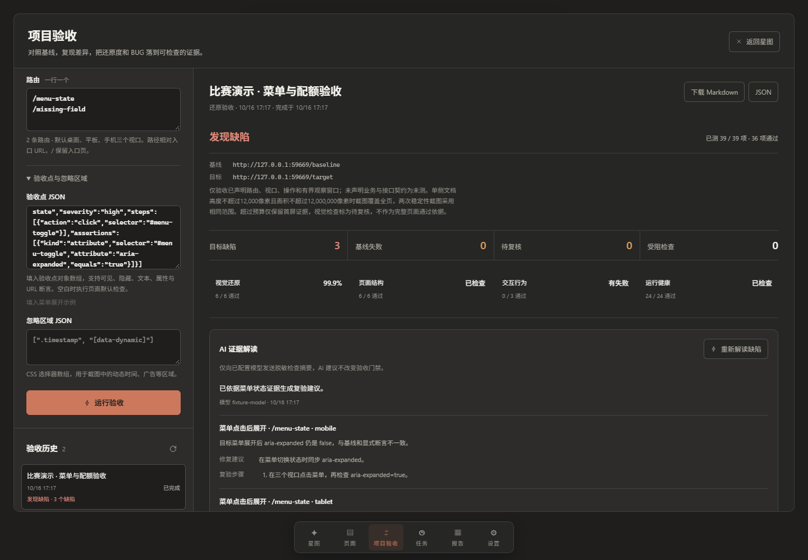
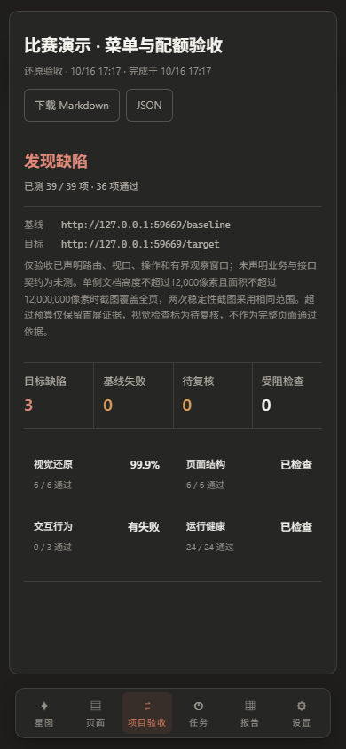

# 项目验收 MVP 证据索引

本目录只包含本地受控夹具与工作台验证证据。完整结论和边界见[实施记录](../../acceptance-workbench.md)。测试中的 `127.0.0.1` 随机端口均已关闭，不能作为长期入口。

- [固定测试集逐案结果](benchmark/benchmark.md)：7 个已知 BUG、4 个非 BUG 的独立真值与评估。
- [控制台检查清单](console/browser-checks.json)：创建、执行、鉴权、下载、刷新、手机布局和模型模拟器闭环。
- [本次报告](console/acceptance-report.json)：39 项检查及每项证据引用、指纹与校验和。
- [Markdown 下载](console/acceptance-downloaded.md)：通过控制台真实下载的报告。
- [AI 真实模型结果](console/ai-triage-configured-model.json)：deepseek-flash 对受控菜单报告的一次实际调用。
- [AI 模拟器结果](console/ai-triage-mock.json)：验证未知检查和门禁改动被丢弃，不能冒充真实模型结果。

`console/run-evidence/` 保留该次任务的 manifest、JSON / Markdown、双方截图、差异图、重复截图、DOM 与网络摘要。报告中的证据文件名相对于该目录，可按 `evidenceManifest` 的 SHA-256 复核。原始无裁剪截图只用于本次夹具；没有真实账户或线上客户数据。

