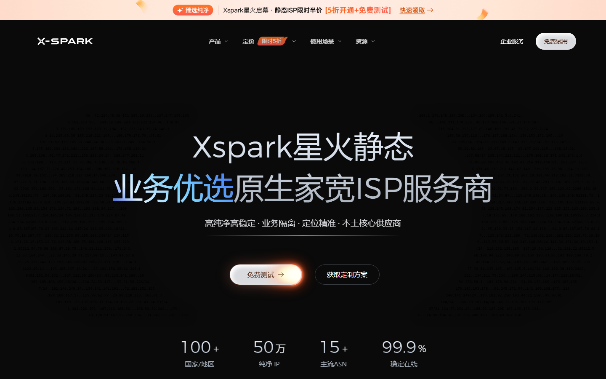

# Xspark 官网公开 QA 案例

这是一份由 Xspark 站点所有者授权、对公开官网执行的只读 QA 记录。目标是给 Heimdall 留下一份真实站点的公开证据，而不是用仓库夹具冒充真实项目。

## 结论

本次检查的 5 个公开页面、2 个视口均能正常打开。没有发现需要自动提单的控制台错误、页面异常、4xx/5xx、坏图或同源坏链。报告仍保留了 57 条无参照物观察项，其中大多数是点击目标尺寸和图片分辨率提示；这些条目没有达到本次 CI 的提单门槛。

跨运行基线已经登记，并完成 10 对同页同视口截图复测。本次没有新增视觉回归发现。

同一轮还通过新 MCP 能力执行了 5 页 SEO 审计：站点分 `90.8 / A`，16 个问题中 critical 0、high 0、medium 6、low 5、info 5；结构化数据、索引、链接和安全分类均为 100 分，内容 98 分，性能 92.8 分。由于没有配置 PageSpeed Insights Key，报告明确标注真实用户字段数据不可用，只保留实验室 LCP 352ms、CLS 0。

## 范围和结果

- 站点：`https://www.xspark.cn/`
- 页面：首页、ISP 代理产品页、数据中心代理产品页、两类定价页
- 视口：`1440x900`、`390x844`
- 页面渲染：10 次
- 建议提单：0
- 按团队约定过滤：2
- 可容忍观察：55
- 无参照物检测命中：65
- 基线复测：10 对，回归发现 0
- SEO 审计：5 页，`90.8 / A`，16 个问题
- 登录态：无
- 写操作：全部阻断

“65 条命中”与“57 条发现”不是同一个口径：前者是检测器在所有页面和视口上的原始命中计数，后者是去重、证据门槛和团队约定处理后的运行发现。

## 复现

在 Heimdall 仓库根目录运行：

```powershell
node core/src/cli.mjs qa ci web `
  --workspace docs/cases/xspark/2026-11-04 `
  --pages '/,/product/isp-proxies,/product/datacenter-proxies,/pricing/isp-proxies,/pricing/datacenter-proxies' `
  --viewports '1440,390' `
  --fail-on all
```

如需复现 SEO 报告：

```powershell
node core/src/cli.mjs seo-audit https://www.xspark.cn/ --max-pages 5
```

公开配置故意使用 `writes: "block"`，比原始 Xspark 测试工作区更严格。它能复现公开页面巡检，但不能代替登录后仪表板、下单、支付和后台管理测试。

## 证据

- [运行报告](evidence/report.md)
- [机器可读运行记录](evidence/run.json)
- [逐条发现](evidence/findings.json)
- [CI 门禁结果](evidence/qa-ci.json)
- [CI 摘要](evidence/qa-ci.md)
- [SEO 结构化报告](evidence/seo.json)
- [SEO CSV](evidence/seo.csv)
- [SEO HTML 报告](evidence/seo.html)
- [SEO 基线](evidence/seo-baseline.json)
- [证据清单](manifest.json)

桌面首页截图：



## 未覆盖

- 登录后的用户仪表板、管理后台和账号数据
- 下单、支付、表单提交、写接口和库存变更
- 价格计算、权限、优惠券、钱包、接口业务语义
- `qa.json` 检查点之外的产品规则
- 真实用户网络环境和所有地区、浏览器组合

## 这次运行实际证明什么

它证明 Heimdall 能在获得授权的外部生产站点上完成一次真实浏览器只读巡检，并生成可复核的报告、截图、发现数据和 CI 门禁结果；它不证明任意网站都能稳定复刻，也不证明所有业务功能都正确。
