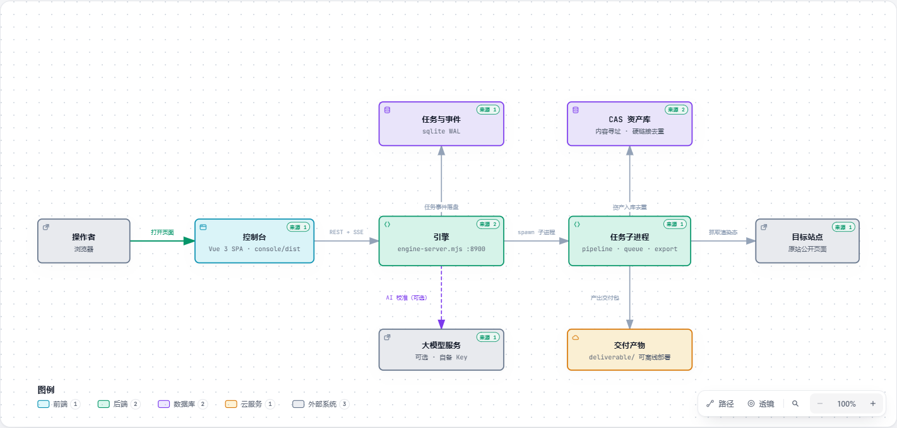

# 01 · 架构

> 读完你会知道：三块代码各管什么、产物落在哪、一次克隆内部发生了什么，
> 以及几个"为什么不那样做"的设计决定。

<p align="center">
  
</p>

## 三层，各管一件事

| 层 | 位置 | 规模 | 一句话职责 |
| --- | --- | --- | --- |
| **控制台** | `console/` | Vue 3，10 个组件 | 只负责"显示与下指令"，不含任何业务逻辑 |
| **引擎** | `core/src/engine-server.mjs` | 单文件，约 1500 行 | 唯一的常驻进程：接 HTTP、排队、拉子进程、记工、托管控制台 |
| **确定性核心** | `core/src/**` 其余 ~90 个模块 | 纯 Node，零外部服务依赖 | 真正干活的那些流程，每个都能单独当命令跑 |

控制台与引擎之间只有一条通道 —— `console/src/api.js` 是控制台里**唯一**拼接 URL 的地方。
引擎对外的接口分四类：

| 类别 | 例子 | 说明 |
| --- | --- | --- |
| 下指令 | `POST /api/clone-site`、`POST /api/recon`、`POST /api/verify` | 立刻返回 `{taskId}`，不阻塞 |
| 看进度 | `GET /api/events?task=<id>` | SSE 长连接，推阶段、日志、分数、退出 |
| 读产物 | `GET /api/pages/:host`、`GET /api/assets/:host` | 读 workspace，带缓存 |
| 静态 | `/static/<host>/…` | 镜像页、截图、报告、交付物；凭据类文件被拒 |

> **为什么不把逻辑写进前端？** 因为抓取要跑几分钟。浏览器标签页会被关掉、被刷新、被切换设备。
> 逻辑在引擎里，"关掉页面活照干"才是真的。

---

## 一次单页克隆，内部走六段

控制台详情面板里那条会逐个亮起的阶段条，就是下面这六段（`core/src/pipeline.mjs`）：

| # | 阶段 | 脚本 | 产出 |
| --- | --- | --- | --- |
| 1 | **capture** | `crawler/capture.mjs` | 用真实浏览器打开原站，存下渲染后的 `dom.html`、`cssom.css`、抓包 `network.har`、若干帧截图 |
| 2 | **build** | `crawler/build_clone.mjs` | 构建镜像：把资产抽出来落到 `clone/assets/`，重写引用，产出 `clone/index.html` |
| 3 | **shot** | `crawler/shot_clone.mjs` | 给镜像拍一张同规格首屏截图（`shot-clone.png`） |
| 4 | **diff** | `differ/diff.mjs` | 与原站截图逐像素比 → `score.json`（三维评分）+ `diff.png`（差异热图） |
| 5 | **fixup** | `differ/fixup.mjs` | **AI 介入点**：按差异形态判断值不值得修，最多校准 2 轮，修不动就保留原样并写明原因 |
| 6 | **harvest** | `harvest/harvest.mjs` | 抽取结构化情报 → `intel/intel.json`（标题 / H1 / CTA / 价格 / 链接） |

整站批量（`queue.mjs`）会把第 1–6 段逐页跑完，**最后统一跑一次跨页汇总**（Excel、站内接线、索引页）——
不能让 60 个页面各自做 60 次全站汇总。

---

## 产物落在哪

```
core/workspace/<host>/            逐页产物（不进 git）
  recon/atlas.json                全站星图：节点、边、失败清单
  pages/<page>/
    dom.html  cssom.css           原站渲染后的 DOM 与样式表原文
    clone/                        镜像（可直接开 index.html）
    network.har                   该页抓包
    score.json  diff.png          还原度评分与差异热图
    intel/intel.json              结构化情报
    fixup-history.json            AI 校准记录（或"为什么没跑"）
  seo/  verify/  audit/           审计与体检报告
  deliver/edit-manifest.md        改站起点清单

core/deliverable/<host>-<date>/        静态交付包
core/deliverable/<host>-live-<date>/   交互镜像包（自包含，可 docker compose up）
```

> **产物目录名 = 页面路径**。`pageNameOf()` 决定这个规则，控制台和引擎各有一份实现，
> 两份必须一致 —— 不一致的后果是链接指向不存在的目录，而且不报错，只是 404。

---

## 三个"为什么不那样做"

### 为什么重活都拉子进程？

因为 Node 是单线程事件循环。一次同步遍历几万个文件，期间**所有**请求都会被冻住 ——
包括 SSE 心跳。所以凡是遍历量大的（磁盘盘点、资产清单、交付包清理、CAS 回收、改站清单），
引擎一律 `spawn` 一个子进程，结果通过一行 `@@EVENT@@` 协议回传。

> 这条协议只有一个实现（`core/src/emit.mjs`），并有守卫测试盯着：**只有它能直接写 `@@EVENT@@`**。
> 起因是一个真实故障：12 个脚本各自复制了一份，某一份悄悄多了个条件分支。

### 为什么不用数据库存产物？

产物要能被**直接打开看**：`clone/index.html` 双击就能在浏览器里看，`atlas.json` 用编辑器就能读。
存进数据库等于给每个消费者加一道 SDK 依赖。所以除了「任务与事件」这类需要原子读写的状态
（用 Node 内置的 `node:sqlite`，WAL 模式），其余一律是磁盘上的普通文件。

### 为什么要有 CAS（内容寻址存储）？

因为同一个小图标、同一份字体，在几十个页面里都出现。CAS 按**内容哈希**存一份，
其余地方用硬链接指向它 —— 61 个页面的站点，磁盘占用可能只有几十分之一。

代价是删除要小心：硬链接数 `nlink === 1` 才算真孤儿（没人再用它了）。
磁盘看板的「预览回收」就是按这条判据列的候选，而且**默认只预览，真删要点两次**。

---

## 确定性体现在哪

- **同一条命令跑两次，产物一致** —— 两个日期的包可以直接 `diff`，看站点到底改了什么
- **侦察节点 id 是 url 的哈希**，不是"第几个访问到的"。侦察是 3 路并发的，
  用自增序号会让"谁先加载完"写进 id，同一个站点两次侦察结果对不上
- **交付包有校验和清单**（`checksums.json`）与**与上次导出的差异**（`changes.json`），
  用户能读到"这次比上次新增了什么、变了什么"
- **AI 不在搬运路径上**。它只在固定输入、固定输出格式的地方做判断，
  所以它的不确定性不会污染"到底像不像"这个结论

---

## 同一站点的三类产物：该拿哪一种

| | 静态镜像 | 交互镜像 | 交付包 |
| --- | --- | --- | --- |
| **是什么** | 冻结的照片 | 会跑的快照 | 能部署的成品 |
| **能做什么** | 看、比、量还原度 | 点按钮、看动效、走一遍功能 | 起服务 / docker compose up |
| **给谁** | 前端照着写第一版 | 想验证"功能能不能跑通" | 要拿去接着改的人 |
| **可复现** | ✅ 完全确定 | ⚠️ 依赖当次抓到的数据 | ✅ 同上 |

完整推理（含"为什么不做增量补丁协议"）见 [../DELIVERY.md](../DELIVERY.md)。
