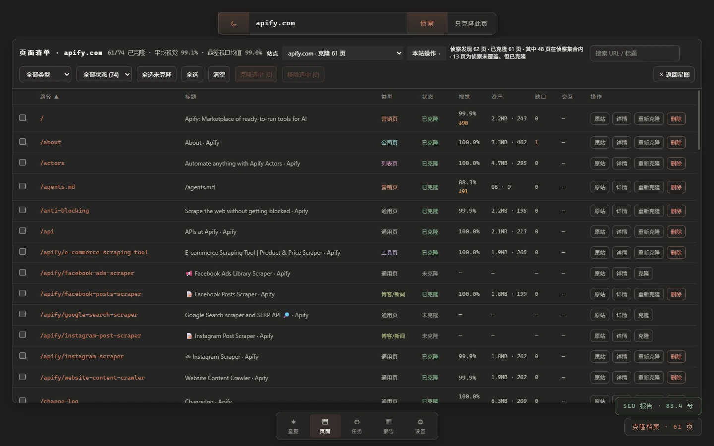
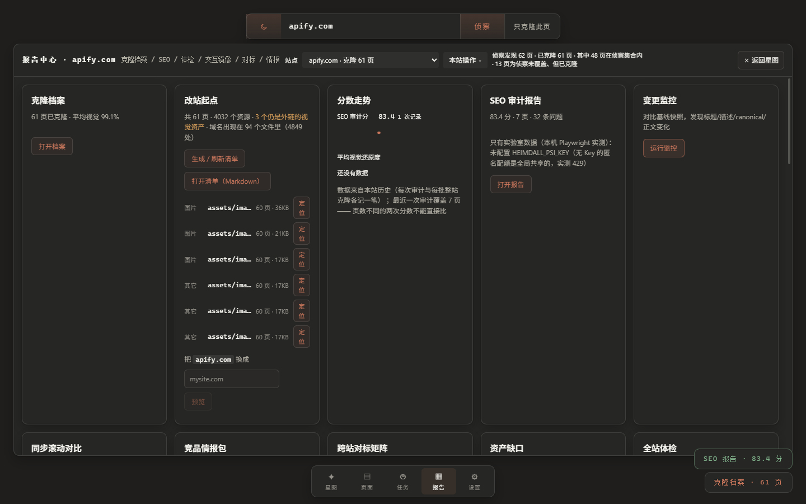

# 02 · 控制台

> 打开 `http://127.0.0.1:8900` 之后，房间里每样东西是干什么的。
> 建议第一次读的时候把界面开着，对着看。

---

## 先认门牌：界面分成六块

```
┌──────────────────────────────────────────────────────────────┐
│  [主题]  [ 域名输入框 ]  [侦察] [只克隆此页]                    │  ← ① 顶部输入条
│  站点 [下拉 ▾]  [本站操作 ▾]   侦察发现 62 页 · 已克隆 61 页…   │  ← ② 站点栏
├──────────────────────────────────────────────────────────────┤
│ ┌──────────┐                                                 │
│ │ 仪表面板  │              星图 / 页面 / 任务 / 报告 / 设置      │  ← ③ 主区域
│ │ 图例·显示 │                                                 │
│ │ 引擎状态  │                                                 │
│ └──────────┘                                                 │
│  HEIMDALL                    拖拽=旋转 滚轮=缩放 点击星球=详情  │  ← ④ HUD 与操作提示
│  61 页面 1544 链接 apify.com                                  │
├──────────────────────────────────────────────────────────────┤
│                    [星图][页面][任务][报告][设置]              │  ← ⑤ 底部导航
│                                    SEO 报告 · 83.4 分          │  ← ⑥ 右下角随时可点
│                                    克隆档案 · 61 页            │
└──────────────────────────────────────────────────────────────┘
```

图中的 61 页、1544 条链接和分数是旧站点的界面示例，非当前运行结果；数值以控制台实际站点和评分版本为准。

### ① 顶部输入条 —— 一切的起点

| 控件 | 做什么 | 什么时候用 |
| --- | --- | --- |
| 域名输入框 | 填目标域名（可带 `https://`） | 第一次面对一个站点 |
| **侦察** | 全站侦察：找出有哪些页、抓标题与类型、生成星图 | **先做这一步**，之后一切才有上下文 |
| **只克隆此页** | 不侦察整站，只把输入框里这一页跑完整条流水线 | 我就想要这一页 / 想先试一页 |

> 「侦察」和「克隆」是两件独立的事。首页做成两个按钮，是因为以前只有一个「侦察」——
> 于是"我只想要这一页"的人被迫先等几分钟全站侦察。

### ② 站点栏 —— 你现在在看谁

- **站点下拉**：切换已侦察 / 已克隆的站点。每一行会写清它到什么程度：
  `克隆 61 页`、`仅审计 35 分`、`克隆 1 页（未侦察）`
- **本站操作菜单**：这个站点能做的事（见下表）。菜单项会**按当前状态自动变化** ——
  比如整站克隆中断过，就会多出一项「继续整站克隆（剩 N 页）」

| 菜单项 | 说明 | 什么时候出现 |
| --- | --- | --- |
| SEO 审计 | 66 条规则六分类，出 HTML / CSV / JSON 报告 | 随时 |
| 整站克隆 / 增量克隆 | 逐页克隆全站；增量模式只重跑源站变过的页 | 随时 |
| **继续整站克隆（剩 N 页）** | 上次没跑完的接着跑，**跳过已完成页** | 上次中断或失败后 |
| 全量重跑 | 忽略"源站变没变"，整站重跑一遍 | 已克隆过至少一页 |
| 页面清单 / 收起清单 | 切到逐页表格视图 | 随时 |
| 登录并保存会话 | 开一个浏览器窗口人工登录一次，之后自动带上 | 需要登录的站点 |
| 删除本站 | 移除该站全部产物（CAS 资产保留） | 随时 |

### ③ 仪表面板 —— 图例与引擎状态

页面类型按颜色区分（营销页 / 定价页 / 文档 / 博客…），这是靠**路径规则 + 页面特征**分类出来的，
不是人工标的。面板底部显示引擎是否在线、克隆槽占用（`0/2` 表示两个并发位都空着）。

### ④ HUD 与操作提示

左上角三个数字：**页面数 / 站内链接数 / 原站**。
注意「61 页面」是**这次侦察抓到的**，不是站点真实总页数 —— 侦察有页数上限（站点配方里的 `maxPages`）。

---

## 五个视图

### 星图 · 先看清这个站长什么样

每个球是一页，球的**大小按被站内链接的次数**，连线是页与页之间的链接。

| 操作 | 效果 |
| --- | --- |
| 拖拽 | 旋转 |
| 滚轮 | 缩放 |
| Ctrl + 拖拽 | 平移 |
| 点击星球 | 打开这一页的详情面板 |
| `Esc` | 关掉面板 / 回到星图 |

> 星图是 canvas，键盘和读屏进不去 —— 所以它**不是**唯一入口：同一批页面在「页面」视图里
> 是一张可排序、可键盘操作的表格。

### 页面 · 日常待得最久的一页

一张表，每行一页。表头可以点（也可以键盘回车）排序。

<p align="center">
  
</p>

| 列 | 含义 | 怎么读 |
| --- | --- | --- |
| **视觉** | 克隆时的单页像素分与多视口最低分 | 主数字来自 `score.json`；`↓90 v2` 来自新版多视口验证。结合尺寸、覆盖率和缺口判断，旧记录不与 v2 混排 |
| **资产** | 这一页的克隆资产体积与文件数 | 突然比别页大很多，通常是没去重的原图 |
| **缺口** | 还挂在外面的视觉资源数 | **> 0 就要处理**：离线打开会 404，上线后会随原站变 |
| **交互** | 交互回放的可观察状态相符数 | `—` 也可能表示未开启回放、未发现交互或结果未核实；控制台体检不启动回放 |
| **操作** | 原站 / 详情 / 克隆 / 删除 | 「克隆」失败或中断时会变成「重新克隆」 |

顶部状态分别显示已克隆/当前清单页数、平均单页像素，以及有完整 v2 数据时的最差视口均值。图中的 `61/74`、`99.1%`、`99.0%` 均为历史示例；先核对侦察页数、已克隆页数和已验证页数，再使用分数作比较。

### 任务 · 谁在跑、跑完了没

两块数据来源不同，所以分开标注：

- **本会话任务**：内存里的，引擎重启就没了；显示"运行中 / 完成 / 熔断"，可点开看实时日志
- **引擎持久化历史**：落在本地数据库里，**重启后仍可查**；中断或失败的任务会带一个「继续克隆」按钮

### 报告 · 所有产物从这里拿走

<p align="center">
  
</p>

卡片从上到下大致是这个顺序：

| 卡片 | 给你什么 |
| --- | --- |
| 克隆档案 | 卡片墙入口：逐页看镜像、带还原度分；含**原站↔镜像同步滚动对比**工具 |
| **改站起点** | 换成你自己的站要动哪些文件：域名 / 图片 / 文案三张表 + 一键定位 |
| 分数走势 | 每次审计与每批克隆各记一笔，看趋势（注意：页数不同的两次不能直接比） |
| SEO 审计报告 | 66 条规则的报告入口 |
| 变更监控 | 与基线快照比，报出标题 / 描述 / canonical / 正文变化 |
| 竞品情报包 | 跨页 Excel：概览 / 语义情报 / 定价与 CTA |
| 跨站对标矩阵 | 两三个站点并排比分数、覆盖率、LCP、页面类型 |
| 资产缺口 / 全站体检 | 缺口清单；多视口体检汇总 |
| 交互镜像 / 交付包 | 导出可部署包、看包的健康报告及与上次的差异 |
| 存储（在下方） | 磁盘占用、CAS 孤儿回收、交付包保留策略 |

### 设置 · 模型服务与偏好

- **模型服务**：填自己的 Key（OpenRouter / DeepSeek / 自建中转…）。Key 只落本地 `core/.env`，**永不回显**
- 引擎地址与 Token、界面偏好

> **不配模型也能用**。缺模型时流水线照跑，只是跳过 AI 校准与情报抽取，
> 并且会在克隆结论里**写明"为什么没跑"**，而不是留一个空白格子让人猜。

---

## 详情面板：点开一页之后

点星图上的星球，或页面表里的「详情」，右侧滑出面板。四个标签页：

| 标签 | 看什么 |
| --- | --- |
| **概览** | 类型、深度、克隆状态、资产体积、视觉缺口、交互通过数、页面标题与描述 |
| **SEO 剖析** | 这一页的 SEO 轻量画像（标题 / 描述 / H1 数 / 图片无 alt 数 / canonical / lang） |
| **质检** | 还原度三维明细、差异形态、AI 校准曲线（或跳过原因）、交互回放逐项、资产缺口 |
| **克隆** | 原站与镜像的**并排首屏截图**、实时运行日志、分数、以及克隆这个动作本身 |

「克隆」页在你点克隆之后才会热闹起来：阶段条逐个亮、日志一行行滚、结束后给出最终分数。
分数出现前它会先显示**运行中与已用时间** —— 整站克隆一页要几分钟，界面上得有东西在动。

---

## 常用操作速查

| 我想… | 怎么做 |
| --- | --- |
| 看看这个站有哪些页 | 输入域名 → 「侦察」 |
| 只要一页 | 输入 URL → 「只克隆此页」 |
| 克隆全站 | 侦察完 → 「本站操作 → 整站克隆」 |
| 站点改版了，只更新变了的页 | 「本站操作 → 增量克隆」 |
| 上次没跑完 | 任务页点「继续克隆」，或菜单里的「继续整站克隆」 |
| 看看像不像 | 页面表看「视觉」列；或报告页 → 克隆档案 → 同步滚动对比 |
| 拿去做自己的站 | 报告页 → 改站起点 → 生成清单 → 换域名（先预览再确认） |
| 导出能部署的包 | 报告页 → 交互镜像 → 导出 |
| 找哪张图还是外链 | 页面表「缺口」列 > 0 的行，或报告页 → 资产缺口 |
| 站点的磁盘占用 | 报告页下方 → 存储 → 重新扫描 / 预览回收 |
