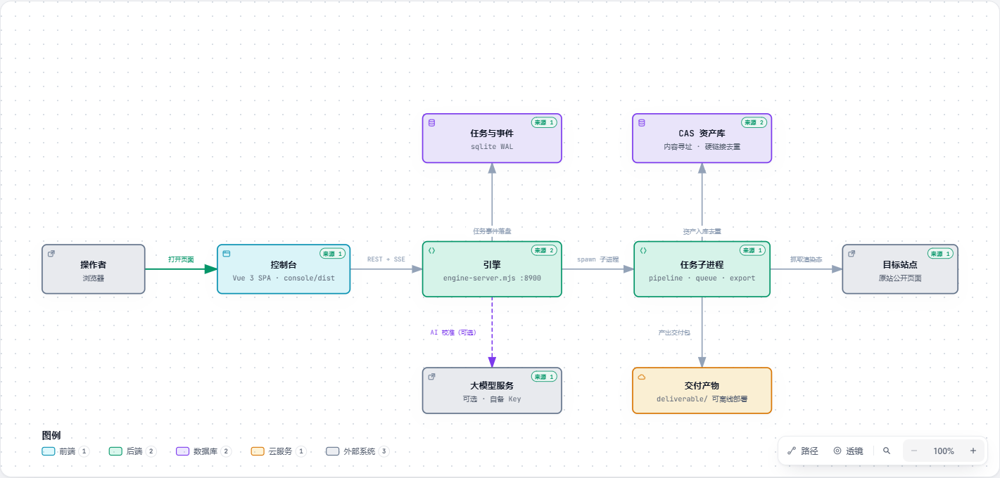
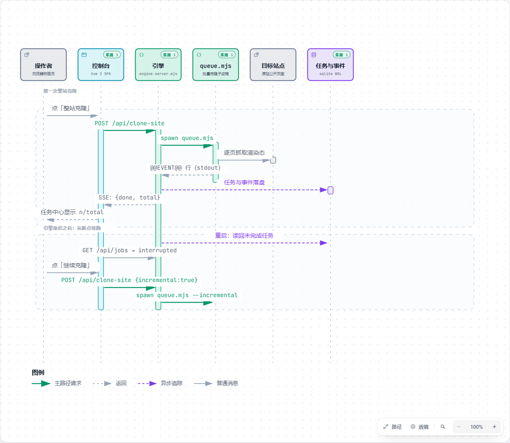

# Heimdall 上手导览

> 这份导览面向**第一次接触这个项目的人**：花五分钟读完这一页，你就知道它是什么、由哪几块组成、
> 打开控制台之后每一步该点哪里。想直接动手，看文末的「最短路径」。

<p align="center">
  
</p>

---

## 一句话：它是一家「复刻工坊」

你给它一个网址，它把那个站点**真实的前端文件**搬回来，装成两样东西：
一份**能打开看的复刻**，和一份**写着"到底像到什么程度"的数字报告**。

和"让 AI 照着截图重写一遍"的区别，可以用做菜打比方：

| | 让模型照着截图重写 | Heimdall 的做法 |
| --- | --- | --- |
| 原料 | 模型凭印象"再画一份" | **原件搬运**：字体、图片、图标就是原站那几个文件 |
| 像不像 | 只能说"看着挺像" | **量出来的**：像素 / DOM / 字段三维打分，A/B/C 分级 |
| 少没少 | 说不上来 | **列清单**：哪几个资源还没落到本地，一条条列出来 |
| 再来一次 | 每次结果都不一样 | **可复现**：同一条命令跑两次，产物可以直接 `diff` |

模型只用在三处**判断**上（页面分类、像素差异的 CSS 校准、语义情报抽取）。
**搬运本身一步都不交给它** —— 这是"结果可核对"的前提。

---

## 三个角色，一句话各说清

把它想成一家工坊，你进来会经过三间屋子：

| 屋子 | 对应代码 | 它负责什么 | 类比 |
| --- | --- | --- | --- |
| **控制室** | `console/` | 你在这里下指令、看进度、翻报告 | 前台的操作台与看板 |
| **车间主任** | `core/src/engine-server.mjs` | 接活、排队、开工单、拉工人、记工时 | 调度台 |
| **工匠与机器** | `core/src/**`（其余 98 个模块） | 真正干活的确定性流程 | 车间里的机器 |

三者之间只有一条通道：**控制室 ↔ 车间主任走 HTTP（REST + SSE）**。
车间主任再往下，一切都是**拉起的子进程**在干 —— 所以关掉浏览器标签页，活照干。

> **为什么这么分？** 如果让浏览器标签页直接驱动抓取，那关掉页面就等于停工，
> 而且刷新一下进度全丢。现在浏览器只是"订阅了一份进度播报"，停了也不影响生产。

---

## 一张图看懂一次干活的全过程

<p align="center">
  
</p>

<sub>📎 想看可交互版（可缩放、可按路径追踪、明暗主题）：[`assets/clone-sequence.html`](assets/clone-sequence.html) ·
架构图交互版：[`assets/architecture.html`](assets/architecture.html)</sub>

这张图回答三个常见疑问：

- **关掉浏览器还会跑吗？** 会。干活的是引擎拉起的子进程，标签页只是订阅了进度。
- **引擎重启了怎么办？** 任务与事件落在本地数据库里；重启后未完成的会被标成「中断」，
  在「任务」页点一下**「继续克隆」**就从断点接上，不会从头再来。
- **为什么进度不卡？** 一条 SSE 长连接推完所有阶段与日志，不是前端反复打接口问。

---

## 目录

| 章节 | 讲什么 | 适合什么时候读 |
| --- | --- | --- |
| [01 · 架构](01-architecture.md) | 三层怎么分、数据放在哪、一次克隆的内部六段 | 想改代码 / 想知道"为什么这么设计" |
| [02 · 控制台](02-console.md) | 五个视图逐个讲：星图 / 页面 / 任务 / 报告 / 设置 | **第一次打开界面时对着看** |
| [03 · 功能全解](03-features.md) | 按"你想干什么"组织：克隆、验证、审计、交付、运维 | 想知道某个功能在哪、怎么用 |

---

## 最短路径

```bash
git clone <repo> && cd heimdall
pnpm install && pnpm -C core exec playwright install chromium
```

**只想先看一眼**（不启动引擎，一页而已）：

```bash
node core/src/cli.mjs forge https://example.com home
# 产物：core/workspace/example.com/pages/home/ —— 打开 clone/index.html 就是复刻
```

**想用控制台**：

```bash
pnpm -C console build
cd core && HEIMDALL_CONSOLE_DIR=../console/dist node src/engine-server.mjs 8900
```

打开 `http://127.0.0.1:8900`。第一次进来是一片空白星图，页面上会写清接下来三步：

1. **侦察** —— 顶部输入框填一个域名，回车。先看清全站有哪些页（几十页通常 1–3 分钟）
2. **克隆** —— 侦察完在星图或「页面」清单里勾选要克隆的页；只想试一页就点「只克隆此页」
3. **拿走** —— 去「报告」页导出交付包；「改站起点」会告诉你换域名 / 图片 / 文案各要动哪些文件

需要登录的站点：先去「本站操作 → 登录并保存会话」人工登一次，之后的侦察 / 克隆 / 审计会自动带上这份登录态。

---

## 几个容易踩的点

- **`pnpm test` 需要浏览器**。测试集里有几条跑的是真实抓取流水线，没装 Chromium 会直接失败。
  先跑 `pnpm -C core exec playwright install chromium`。
- **产物不进 git**。`core/workspace/`（逐页产物）与 `core/deliverable/`（可部署包）都在 `.gitignore` 里；
  想挪走就用环境变量 `HEIMDALL_DATA_DIR`。
- **引擎默认只听本机**。`HEIMDALL_HOST` 可改；设了 `HEIMDALL_TOKEN` 之后 `/api/*` 需要带 token。
- **交付包默认听所有网卡**（它是拿去部署的），只在本机预览用 `node serve.mjs --host 127.0.0.1`。
