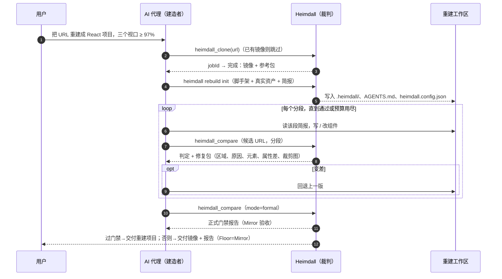

# 03 架构

上一篇：[02 战略](02-strategy.md) · 下一篇：[04 需求](04-requirements.md)

原则：**加法，不动旧路径**。现有引擎、验收子系统、控制台原样保留，新能力挂在新目录、新路由、新命令下。

---

## 1. 分层

| 层 | 内容 | 状态 | 建议位置 |
| --- | --- | --- | --- |
| **L5 外壳** | CLI（代理模式）、MCP v2、HTTP v1、技能与插件包、控制台新视图 | 新 / 扩展 | `core/src/cli.mjs`（扩展）、`packages/mcp/`、`core/src/api/v1.mjs`、`plugin/`（Claude Code 插件根：技能、子代理、命令、`.mcp.json`）、仓库根 `.claude-plugin/marketplace.json`、`console/src/` |
| **L4 闭环** | 重建环、行为环、契约环；收敛控制器；Autopilot（赛后） | 新 | `core/src/agent/loops/`、`core/src/agent/autopilot/` |
| **L3 证据引擎** | 简报、分段、对比、修复包、元素对应、围栏与脱敏、出处标注 | 新 | `core/src/agent/evidence/` |
| **L2 能力注册表** | 能力的唯一定义；生成 L5 的各外壳与文档 | 新 | `core/src/agent/registry/` |
| **L1 控制面** | 任务门面（排队、幂等、进度、取消、预算）、令牌与作用域、审计日志、事件总线 | 新 | `core/src/agent/control/` |
| **L0 现有引擎** | `recon / forge / queue / verify / live / acceptance / seo …`、`engine-server.mjs`、`jobs.db` | **不改** | 现有 |

依赖方向只能向下：外壳 → 闭环 → 证据 → 注册表 / 控制面 → 现有引擎。MCP 服务器**不持有状态**：它是引擎的 HTTP 客户端，找不到本机引擎时按 `handoff.mjs` 的做法自起临时引擎（并核对数据根一致，避免「引擎说完成但产物写到别处」）。这保证代理和控制台看到的是**同一个引擎、同一份任务**——这是「AI 活动」视图成立的前提。

---

## 2. 能力注册表（Capability Registry）

### 2.1 为什么需要

今天同一个能力在 CLI、HTTP、MCP 里各写一遍，已经出现漂移（[01 §1.2](01-background.md)）。注册表把「一个能力长什么样」写在一处，其余全部生成。

### 2.2 能力定义

```js
// core/src/agent/registry/capabilities/compare.mjs（示意，字段为准）
export default {
  id: 'compare',   // MCP: heimdall_compare · CLI: heimdall compare · HTTP: POST /api/v1/tools/compare
  title: '对比候选与参考',
  description: 'Measure a candidate page (URL or project dir) against the frozen reference ' +
    'at 375/768/1440 and return a verdict plus a Fix Packet. Use after every edit; ' +
    'fast mode cannot declare "passed" (use mode:"formal" for that).',
  effects: ['browser'],               // read | write-local | browser | source-network | destructive
  scope: 'build',                     // read | clone | build | admin
  idempotent: true,
  longRunning: 'mode==="formal"',     // fast 同步返回；formal 返回 jobId
  cost: 'medium',                     // cheap | medium | heavy（用于预算与客户端提示）
  input:  { /* JSON Schema 2020-12 */ },
  output: { /* JSON Schema 2020-12，含 summary、nextActions、evidence[] */ },
  artifacts: ['fixpacket', 'gate'],
  legacy: [],                         // 兼容的旧工具名
  handler: (args, ctx) => compare(args, ctx),
};
```

### 2.3 效果等级与派生

| `effects` | 含义 | MCP 注解 | 令牌作用域 |
| --- | --- | --- | --- |
| `read` | 只读工作区产物 | `readOnlyHint: true` | `read` |
| `write-local` | 写工作区或重建工作区 | `readOnlyHint: false`，`destructiveHint: false` | `clone` / `build` |
| `browser` | 在本机启动 Chromium（访问本机候选或本地镜像） | 同上 | `build` |
| `source-network` | 访问源站 | `openWorldHint: true` | `clone` |
| `destructive` | 删除或覆盖（回收站清空、`replace-domain --apply`、交付包隔离、会话清除、删站） | `destructiveHint: true` | `admin`，**默认代理档不暴露** |

从一份定义派生：

| 生成物 | 内容 |
| --- | --- |
| HTTP | 路由表与 `GET /api/v1/openapi.json`；统一信封（字段见 [附录 C §1](appendix-c-schemas.md)） |
| MCP | `tools/list`（确定性顺序）、`inputSchema` / `outputSchema`、注解、`resources` 与 `prompts` 清单 |
| CLI | 子命令、参数解析、`--help --json`（机器可读的命令清单，给代理做发现） |
| 文档 | [附录 A](appendix-a-tools.md) 的表；技能里的速查表 |
| 权限矩阵 | 令牌作用域 × 能力 |

**CI 检查**：重新生成并与已提交的生成物 diff，不一致即红（E1-05）。

---

## 3. 控制面（Control Plane）

### 3.1 任务模型 v2

在现有 `tasks` Map + `jobs.db` 之上加一层门面，**不改**现有任务机制。

| 方面 | 设计 |
| --- | --- |
| 状态 | `queued → running → (waiting_input) → succeeded \| failed \| cancelled \| expired` |
| 排队 | 现有「同类只能一个」的全局槽在门面处变成**排队**：占用时返回 `queued` 与位置，而不是 `409 busy`。底层槽不动 |
| 幂等 | `Idempotency-Key`（HTTP）/ `idempotencyKey`（参数）：同键同参数返回同一个 `jobId`，同键不同参数返回冲突 |
| 进度 | 统一事件 `{seq, ts, kind, stage, pct?, message}`，来源是子进程的 `@@EVENT@@`；输出到 SSE、MCP `notifications/progress`（请求内）、`heimdall_jobs` 轮询 |
| 取消 | 复用 `POST /api/jobs/:id/cancel`；门面统一语义，取消后清理子进程树 |
| 长任务的两条路 | ① **通用**：工具立即返回 `jobId` + `nextActions`，代理用 `heimdall_jobs(wait)` 轮询——所有客户端可用。② **Tasks 扩展**：客户端协商了 `io.modelcontextprotocol/tasks` 时，`jobId` 同时作为 `taskId`。MVP 只做 ① |
| 存储 | 新建 `agent.db`（`node:sqlite`，与 `jobs.db` 同样的降级策略）放在数据根，存令牌、预算计数、幂等键、重建账本索引；**不改 `jobs.db` 表结构** |

### 3.2 令牌与作用域

| 作用域 | 能做什么 |
| --- | --- |
| `read` | 读站点、简报、制品、任务状态 |
| `clone` | + 访问源站、写工作区（侦察、克隆、验证、导出） |
| `build` | + 创建重建工作区、对比候选、正式验收 |
| `admin` | + 破坏性操作、设置、令牌管理 |

- 令牌哈希后存于 `agent.db`，控制台与 CLI 可创建 / 撤销 / 设预算与过期。
- 现有 `HEIMDALL_TOKEN` 等价于 `admin`，保持兼容。HTTP v1 同时接受 `x-heimdall-token` 与 `Authorization: Bearer`。
- **本机回环 + 未设令牌**：保持今天的行为（不鉴权），但破坏性能力仍需 `requireLocalWrite`。
- 远程模式（绑定非回环地址）**必须**有令牌，且默认关闭 `source-network` 对私有地址的访问（[08 §4](08-security-governance.md)）。

### 3.3 预算

每个令牌和每个任务可带预算：`maxPages`、`maxWallMs`、`maxToolCalls`、`maxLlmUsd`（仅 Autopilot 与 Bench 使用），另有并发任务数与读取体积两个维度（默认值与行为见 [08 §5](08-security-governance.md)）。默认宽松但有限；用尽时返回 `budget_exceeded` 与 `nextActions`，而不是静默停止。

### 3.4 审计日志

追加写 JSONL：`{ts, client, tokenId, tool, argsHash, jobId, durationMs, status, costUsd?}`，参数只存哈希与脱敏摘要。路径 `<数据根>/audit/agent-YYYYMMDD.jsonl`；写入失败时本机模式放行并在控制台告警，共享模式暂停写类能力（fail-closed）。控制台的「AI 活动」读它，也用于事后复盘（[08 §6](08-security-governance.md)）。

---

## 4. 数据模型

### 4.1 实体

| 实体 | 说明 | 是否可重建 | 关键点 |
| --- | --- | --- | --- |
| Site / Page | 现有 | — | `siteId` 沿用现有身份规则（含同主机多 origin 的 sibling ID） |
| **参考包 ReferencePack**（`heimdall.reference/1`） | 页面的冻结参考：三视口截图、动态区域遮罩、DOM 快照引用 | 可重建（来自镜像） | 正式裁判的 baseline 指向它的「正式基线副本」，由 `Gate` 封装每次运行起临时回环服务供给，不走带令牌的引擎静态路由，也不指向会漂移的活站（Ph0 S4，[05 §1.5](05-frontend-rebuild.md)） |
| **简报 Brief** | 给代理看的压缩证据 | 可重建 | 含 `untrusted` 围栏、token 预算、出处 |
| **分段 SectionPlan** | 稳定的分段 ID、各视口边界框、DOM 锚点、依赖（共享组件先行） | 可重建 | 并行构建的基础 |
| **候选 Candidate** | 代理产出：项目目录或 URL | 否 | 由 `heimdall.config.json` 描述 |
| **对比 CompareRun / 修复包 FixPacket** | 一次度量的结果与修复线索 | 可重建 | 快速裁判产物，不能宣布通过 |
| **门禁 Gate** | 阈值 + 逐维判定 + 证据引用 | 否 | 正式裁判产物；配置在一次运行内冻结并记录哈希 |
| **重建运行 RebuildRun** | 迭代账本（飞行记录器） | 否 | 每次迭代：分数前后、保留 / 回退、token、花费、模型 |
| **旅程 Journey** | 人在可见浏览器里的一次操作录制 | 否 | 含原始 HAR（秘密级，不外发） |
| **行为规格 BehaviorSpec** | 组件状态机 + 流程 + 断言 | 可重建（来自旅程 + 操作发现） | 每项带出处 |
| **契约草案 ContractDraft** | OpenAPI + 观察统计 + 样例 + 未知清单 | 可重建（来自清洗后的 HAR） | 每个端点 / 字段带出处与置信度 |

字段级 schema 见 [附录 C](appendix-c-schemas.md)。

### 4.2 URI 与存储布局

资源 URI（MCP `resources`、HTTP、CLI 通用）：

```
heimdall://sites
heimdall://site/{siteId}/atlas
heimdall://site/{siteId}/page/{page}/brief
heimdall://site/{siteId}/page/{page}/sections
heimdall://site/{siteId}/page/{page}/ref/{viewport}.png
heimdall://run/{runId}/fixpacket
heimdall://run/{runId}/crop/{regionId}/{ref|cand|diff}.png
heimdall://job/{jobId}
heimdall://journey/{journeyId}
heimdall://site/{siteId}/contract
```

磁盘上新增一棵子树，其余不动：

```
workspace/<siteId>/agent/
  briefs/<page>.json
  sections/<page>.json
  compare/<runId>/{fixpacket.json, crops/*.png}
  rebuild/<runId>/{state.json, ledger.jsonl, metrics.json}     # metrics.json 是账本的汇总（09 §1.4）
  journeys/<journeyId>/{journey.json, steps/*, network.journey.har}   # network.journey.har 是秘密级
  contract/{openapi.json, observations.json, fixtures/*, unknowns.json}
```

旅程的原始录制命名为 `network.journey.har`，**天然命中**现有 `isSecretFile` 的规则（以 `network` 开头）；另加 `isSecretPath()` 按目录兜底：`agent/journeys/<id>/` 下除清洗后的 `journey.json` 与 `steps/*` 之外的文件都按秘密级处理，所有新工具与资源读取统一先过它（E12-02，[08 §2.2](08-security-governance.md)）。

### 4.3 重建工作区（Rebuild Workspace）

`heimdall rebuild init <url|siteId> --stack <profile>` 生成一个**独立目录**，它是人、代理、CI 之间的合同：

```
my-clone/
├── AGENTS.md              ← 生成：怎么闭环、命令清单、门禁、已知缺口（CLAUDE.md 引用它）
├── heimdall.config.json   ← siteId、页面↔路由、dev server、视口、保真旋钮、门禁、预算
├── .heimdall/
│   ├── brief/<page>.json
│   ├── sections/<page>.json
│   ├── ref/<page>/<viewport>/…png        ← 参考截图（按分段裁剪）
│   ├── runs/<runId>/…                    ← 每次对比的修复包与裁剪图
│   └── ledger.jsonl                      ← 飞行记录器
├── public/assets/…        ← 原件资产（来自 CAS：字体、图片、图标），不让代理重画或外链
└── src/…                  ← 技术栈脚手架
```

```json
// heimdall.config.json（示意）
{
  "siteId": "thordata.com",
  "stack": "vite-react-ts-tailwind",
  "devServer": { "command": "pnpm dev --port 5199", "url": "http://127.0.0.1:5199" },
  "pages": [{ "name": "home", "route": "/", "sections": "auto" }],
  "viewports": [375, 768, 1440],
  "fidelity": "balanced",
  "modelClass": "standard",
  "gate": { "level": "silver" },
  "budget": { "maxIterationsPerSection": 4, "maxUsd": 8, "maxWallMinutes": 45 }
}
```

有了它，**不支持 MCP 的代理也能干活**：读 `AGENTS.md` → 改 `src/` → `heimdall compare --project .`（零参数）→ 读 `.heimdall/runs/` 下的修复包。

---

## 5. 三个闭环

### 5.1 重建环的节拍



文字版：① 取证（已有镜像则复用）→ ② 初始化工作区 → ③ 按分段循环「写 → 对比 → 修」→ ④ 正式验收 → ⑤ 交付（通过则重建项目，否则镜像 + 报告）。逐步细节见 [05](05-frontend-rebuild.md)。

### 5.2 行为环

输入是行为候选（操作发现 + 旅程 + 动效档案 + DOM 中的表单 / 展开控件），输出是行为规格与一组通过的流程。AI 实现交互后，Heimdall 在**源站（或冻结镜像）与重建站**上回放同一组流程，比较**可观察结果**（可见性、文本、ARIA 状态、URL、请求类别）。写操作不对源站回放，只在人录制旅程时被记录（[06 §1](06-logic-backend.md)）。

### 5.3 契约环

输入是清洗后的 HAR（捕获 + 旅程），先用确定性算法聚类（方法 + 路径模板）、推断参数与响应 schema、检测分页、提取错误形状，得到契约草案；AI 补命名、实体模型、规则假设（标 `inferred`）；然后生成适配器或服务；Heimdall 用「训练集重放 + 留出集重放 + 源站只读对照 + 断网严格门禁」验证（[06 §3–4](06-logic-backend.md)）。

### 5.4 收敛控制

| 规则 | 默认 | 说明 |
| --- | --- | --- |
| 迭代上限 | 分段 4、页面 8 | 可在 `heimdall.config.json` 改 |
| 停滞 | 连续 2 次提升 < 0.2 个百分点 | 触发升级：① 该段切到 `faithful` ② 拆成子分段 ③ 请求人类提示 ④ 接受残差并记录 |
| 回退 | 分数变差 | `compare` 返回 `trend: "worse"` 与「建议回退」；Autopilot 自动回退（git） |
| 振荡 | 同一区域在两个状态间来回 | 冻结该区域，升级 |
| 预算 | 美元、墙钟、工具调用 | 用尽即停，状态 `budget_exhausted`，附 `nextActions` |
| 终态 | `passed`、`passed_with_residuals`、`failed_with_residuals`、`budget_exhausted`、`cancelled` | 每个终态都带证据与残差清单；失败是合法结果 |

### 5.5 两个裁判

| | **快速裁判 Fast Compare** | **正式裁判 Formal Gate** |
| --- | --- | --- |
| 实现 | 新：复用 `differ` / `verify` 的像素与形态原语，加几何 + 文本对应；不写验收目录 | 现有：验收 Mirror（`POST /api/acceptance/runs`），完整证据与 SHA-256 |
| 耗时 | 秒级（目标 ≤ 20 秒 / 页 / 三视口，【假设 A-6】） | 分钟级 |
| 并发 | 可并发（只读 + 浏览器槽） | 同引擎一次一个 |
| 输出 | 修复包 + 趋势 | 报告 + 门禁 + 证据 |
| 何时用 | 循环内每次迭代 | 每段收敛后、最终交付前、CI |
| 能否宣布「通过」 | **不能**，只能指导 | **唯一**能宣布通过的来源 |

两个裁判分开，是为了让循环既快又不失信：循环里的判断可能有偏（几何对应是近似），**通过**只能由完整证据的正式裁判宣布（P1）。

---

## 6. Autopilot 引擎（赛后）

Autopilot = 由 Heimdall 自己驱动的闭环（控制台一个按钮）。有三种引擎，**MVP 只做 E0**。

| 引擎 | 谁驱动循环 | 模型 | 优点 | 缺点 | 阶段 |
| --- | --- | --- | --- | --- | --- |
| **E0 外部代理** | 用户的 Claude Code / Codex / Cursor | 用户自带 | 零额外基础设施；用的是最强的代理外壳；Heimdall 不必持有 Key | 依赖用户环境；难以统一预算 | **MVP** |
| **E1 Agent SDK 封装** | Heimdall 起一个 Claude Agent SDK 会话（内置读写 / 命令工具 + Heimdall MCP + 本仓库技能） | Claude（API Key） | 质量最高、实现量小；子代理可并行分段 | 仅 Claude；需要 API Key；需要沙箱 | Ph4 |
| **E2 原生编排** | Heimdall 代码控制循环，模型只做无状态调用（返回补丁 JSON） | 任意（OpenAI 兼容 / Anthropic / 国产模型） | 可复现、可回放、模型无关、成本控制最细 | 自主性较低；需扩展 `llm.mjs`（工具调用、流式） | Ph4–5 |

共同约束（写进 E10）：
- 只用 API Key；**不依赖 claude.ai 登录**（官方不允许第三方产品提供）。
- 必须处理 `refusal` 停止原因并启用服务端降级；不得对 5.x 模型发送已移除的参数（`budget_tokens`、采样参数、强制 `tool_choice`）。
- 生成代码的构建与运行在重建工作区内，`install` 先 `--ignore-scripts`，不继承秘密环境变量；可选 Docker 隔离。
- 全程写飞行记录器，支持**回放**（演示降级用，回放必须明确标注为回放）。

---

## 7. 信任边界

| 边界 | 穿过的东西 | 主要风险 | 控制（详见 [08](08-security-governance.md)） |
| --- | --- | --- | --- |
| B1 网页内容 → 代理 | 简报里的文本、属性、标题、注释 | 提示注入 | 围栏 + `untrusted` 标记；以结构化摘要代替原文；字符上限；指令式文本告警 |
| B2 代理 → Heimdall 工具 | 工具参数 | 越权、滥用、成本失控 | 作用域、预算、审计；破坏性能力默认不暴露 |
| B3 Heimdall → 源站 | 网络请求 | 副作用（GET 写入）、SSRF（远程模式） | 默认只读；远程模式禁私有地址；写操作只在人录制时发生 |
| B4 Heimdall → 磁盘 | 会话、原始 HAR、操作计划 | 秘密外泄 | `isSecretFile` 继承并扩展；工具输出过脱敏 |
| B5 重建项目 → 本机执行 | `npm install`、dev server | 供应链、恶意代码执行 | 脚手架锁版本、`--ignore-scripts`、无秘密环境、可选容器 |
| B6 插件 / 技能 → 代理 | 技能正文、钩子、MCP 配置 | 供应链、过宽的 `allowed-tools` | 最小权限、固定版本、发布前审查清单 |
| B7 数据 → 模型服务商 | 截图、DOM 摘要 | 数据外流 | 外流预览、`--no-images` / 脱敏开关、审计 |
